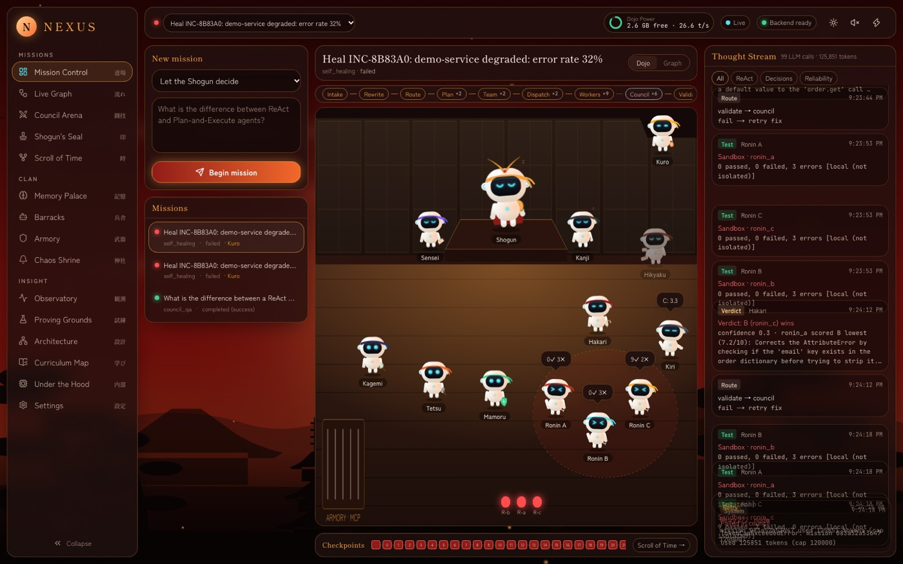
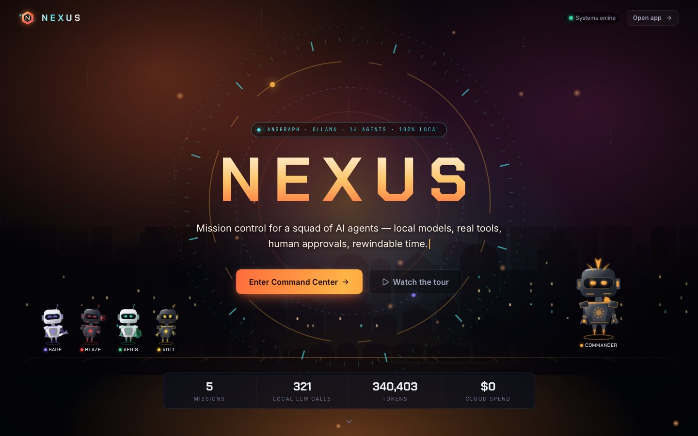
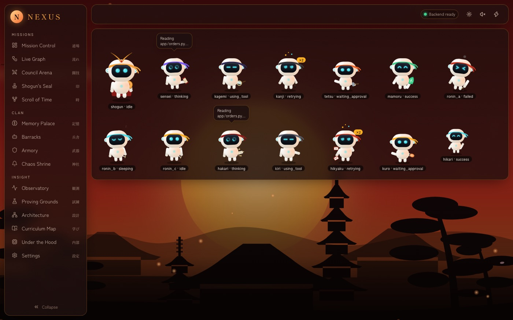
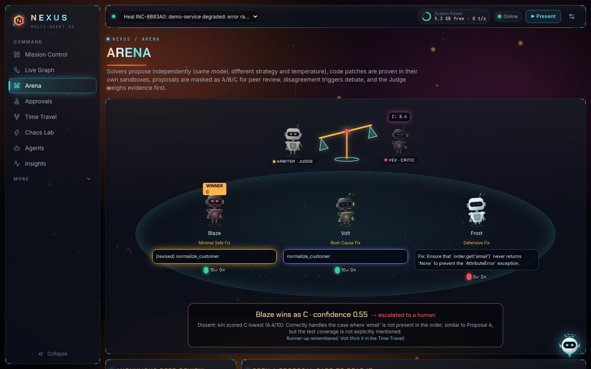
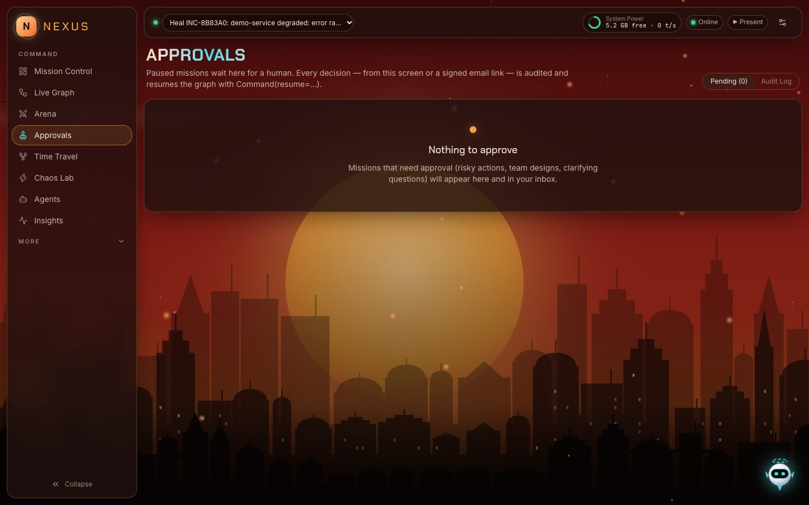
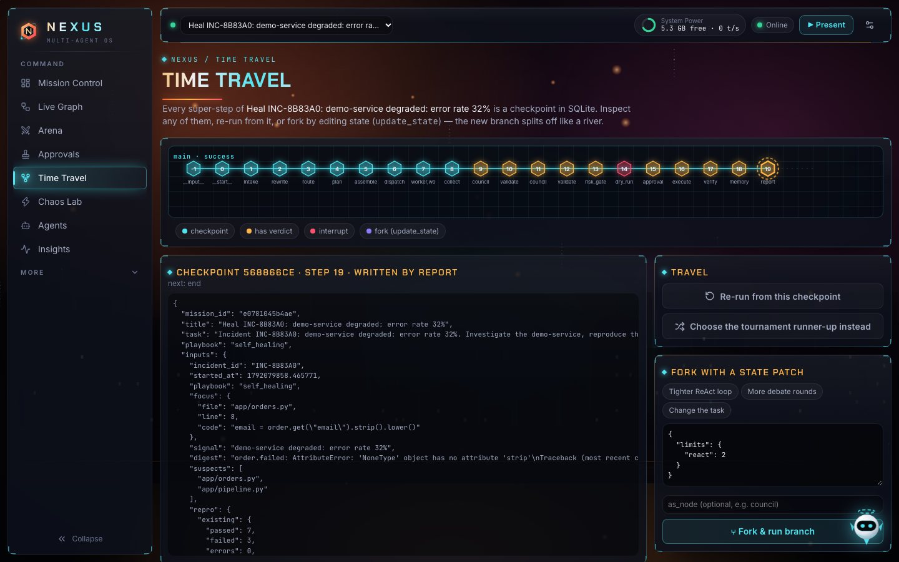
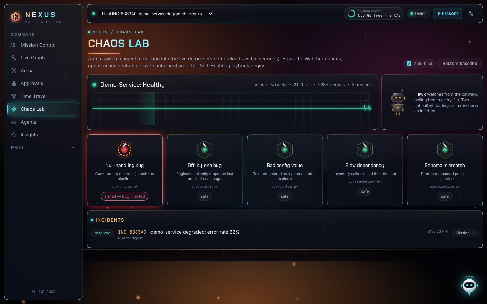
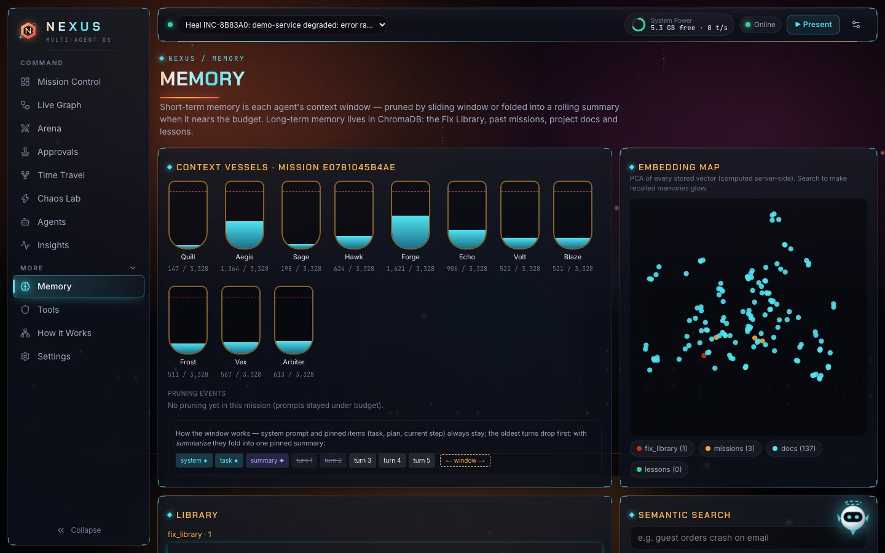
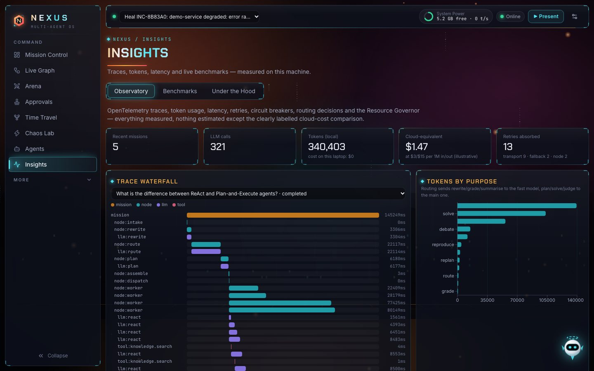
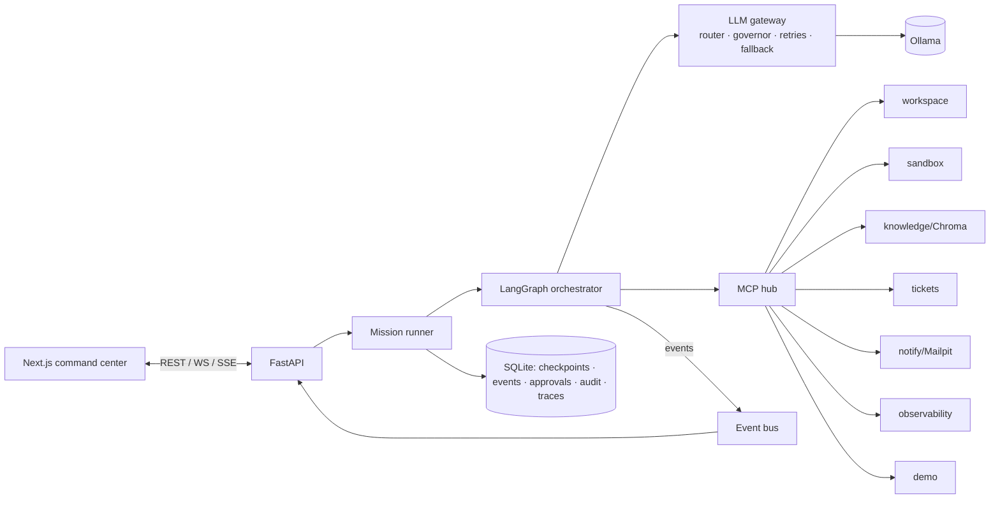

# NEXUS — a dynamic multi-agent command center on local models

NEXUS is a multi-agent orchestration system built with **LangGraph** on **local open
models (Ollama)**. It has layered **automated retries**, **SQLite persistence** and
**human approval gates**, and it runs entirely on a 16 GB MacBook. You give it a task;
the Commander (supervisor) routes it to a playbook, plans, delegates to a squad of agents,
runs evidence-grounded tournaments, asks a human before anything risky, and keeps every
step rewindable.

The UI is "Sunset Command", a sci-fi HUD: a void-black base under sunset aurora light,
neon corner-bracketed panels, a rolling grid horizon and original animated mecha robots.
Every animation in Live mode is driven by a real backend event.



## Quick start

Prerequisites: macOS or Linux, [uv](https://docs.astral.sh/uv/), Node 22,
[Ollama](https://ollama.com). Docker is optional (Mailpit plus an isolated sandbox).

```bash
make setup     # uv sync + pnpm install, creates .env
make models    # pulls llama3.2:3b + nomic-embed-text (lite profile, ~2.3 GB)
make dev       # backend :8000 (also launches the demo-service :8100), frontend :3000
make prod      # same ports, optimised build without dev compiling or reloaders: fastest
```

Open <http://localhost:3000>. For the walkthrough, see
[docs/DEMO_SCRIPT.md](docs/DEMO_SCRIPT.md) or press **▶ Present**.

Optional extras:

- `make mail` starts Mailpit for approval e-mails (<http://localhost:8025>).
- `make sandbox-image` builds the network-less Docker test runner (otherwise tests run
  in a clearly labelled local fallback).
- Set `NEXUS_MODEL_PROFILE=standard` to use qwen2.5-coder:7b as the main model (needs
  ~7.5 GB free).
- `NEXUS_LLM_PROVIDER=simulation` runs without Ollama on a scripted model (the UI shows
  a SIMULATION badge).

## What it does

| Playbook | What happens |
|---|---|
| **Self-Healing** (flagship) | Arm a chaos switch in the Chaos Lab and a real bug goes into the live demo-service. Hawk the Watcher opens an incident. The squad investigates in parallel, reproduces the bug with a test, and three Challengers propose patches; each patch runs in its own sandbox. After anonymous review, a judge, a dry run and **your approval** (UI or signed e-mail link), the fix lands on a git branch with hot reload. It is **verified on live traffic**, rolled back automatically if errors return, and stored in the Fix Library. |
| **Ticket Solver** | Reads a ticket (local tracker or GitHub Issues), writes an acceptance test that must fail first, runs a tournament, then attaches the test report, diff and logs to the ticket after approval. |
| **Project Builder** | Small services only (≤ 8 files: a FastAPI CRUD API or a CLI). Builds from a spec and a template, writes files in dependency waves, repairs until the tests pass, and packages a zip. |
| **Council Q&A** | Parallel answers, anonymous peer review, debate on disagreement, and a verdict with confidence and dissent. |
| **Dynamic** | For anything else. The Commander composes a team from the registry and you approve the team before it runs; a successful run can be saved as a YAML playbook. |

## Verified on this machine (llama3.2:3b, lite profile)

- **Self-heal, end to end:** null-handling bug → incident → 2 council rounds (round 1's
  patches failed 2/10 tests; the failing tests were fed back) → winning patch passed
  10/10 in the sandbox → HIGH risk → dry run → human approval → applied →
  **103 live orders, 0 new errors** → promoted to `main` → Fix Library.
- **Crash recovery:** a backend restart mid-mission resumed it from its SQLite checkpoint.
- **Policy cap:** a mission was stopped at 124,576 tokens against the 120,000 cap, with a
  dead letter written and nothing changed.
- **Raw SDK vs LangGraph agent** (Benchmarks): both 2/3 correct, ~3.9 s and
  ~1,600 tokens per task. Both missed `(144/12)**2 - 40`, which is a 3B reasoning limit,
  not a framework one.

- **Pruning** (420-token budget, ~70% of tokens removed): the sliding window kept 0/3
  early facts answerable and summarisation kept 1/3. This is why `summarise` is the
  default.
- **Council vs single model** on 4 easy factual questions: single 4/4 in ~3 s, council
  3/4 in ~23 s. The council answered "Not Found" without the code 404. On easy recall
  the council only adds latency; its value is in code mode, where sandbox tests decide.
  Treat this as an honest negative result.

The 3B model often needs the second tournament round. The design leans on test evidence
precisely because the model is small. The `standard` profile (7B coder) is expected to
do better, but I have not benchmarked it here.

## Screens

| | |
|---|---|
|  Landing |  Agents |
|  Arena |  Approvals |
|  Time Travel |  Chaos Lab |
|  Memory |  Insights |

Also included: Live Graph with State Inspector, Tools (MCP), Insights tabs (Observatory,
Benchmarks, Under the Hood), How it Works tabs (Architecture Explorer, Curriculum Map),
Settings, Replay mode, Nova the guide, the ⌘K palette, and Presentation Mode.

The robots are animated SVG mecha: hover thrusters, LED visors with expressions, a reactor
core, and per-state effects (holo rings while thinking, sparks on tool calls, an RGB glitch
while retrying, a hologram card while waiting for approval, a barrel-roll on success,
power flicker on failure). Each effect is triggered by a real backend event.

## Architecture



Presenting it? See [docs/PRESENTATION_GUIDE.md](docs/PRESENTATION_GUIDE.md). Learning how it
works inside? See [docs/HOW_IT_WORKS.md](docs/HOW_IT_WORKS.md).

Details: [docs/ARCHITECTURE.md](docs/ARCHITECTURE.md) · decisions: [docs/adr/](docs/adr/) ·
course mapping: [docs/TOPIC_COVERAGE.md](docs/TOPIC_COVERAGE.md).

## Tests and quality

```bash
make check     # ruff + ruff format + mypy --strict, eslint + prettier + tsc, pytest + vitest
make e2e       # Playwright: every screen error-free, mission → approve → complete, time travel, guide
```

- **Backend:** 71 pytest tests. They cover reducers, pruning, guardrails, risk,
  tournament scoring, the gateway (routing, re-prompts, escalation, fallback, breakers),
  the governor, the raw agent, all MCP servers, graph behaviour (routing, fan-out/fan-in,
  cycle guards, interrupts, crash resume), HITL (e-mail tokens, override, time travel),
  and every playbook end to end. The Self-Healing tests use a real demo-service
  subprocess and real sandbox pytest runs; only the LLM is scripted. `@pytest.mark.live`
  tests need Ollama and are deselected by default.
- **Frontend:** 11 Vitest tests (event reducer, robot state machine, legacy ids, scenery) and
  10 Playwright tests against a Simulation-mode backend, including a sweep that opens every
  screen and fails on any console error.
- **CI:** `.github/workflows/ci.yml`. It sits under `assignment4/` and runs when this
  folder is its own repository.

## Known limitations

- **Small-model quality.** With 3B models, tournaments often need a retry round, and
  free-form planning and Project Builder output are hit-and-miss. Validation, fallbacks
  and safe defaults keep missions safe, not always successful.
- **Sandbox isolation needs Docker.** The local fallback is not isolated (no network
  restriction) and says so in every result.
- **E-mail** needs Mailpit or another SMTP server. Otherwise messages go to the outbox
  table and the UI shows that.
- **Subgraph checkpoints.** Subgraphs are not checkpointed internally, so a crash
  mid-tournament re-runs that tournament step.
- **Settings scope.** Live settings changes are runtime-only; persistent ones go in `.env`.
- **Single user.** The UI has no authentication. Run it on localhost.

## Roadmap

Benchmark the `standard` profile and qwen3 models · an MLX backend behind
`LLMProvider` · an OTLP exporter to Arize Phoenix (the compose profile exists) ·
Playwright screenshots attached as ticket evidence for UI tickets · per-user auth.

## Repository layout

```
backend/   FastAPI + LangGraph (nexus/…), tests/
frontend/  Next.js 15 command center UI, e2e/
demo-service/  the orders service NEXUS watches and heals
sandbox/   Dockerfile for the isolated test runner
docs/      ARCHITECTURE, TOPIC_COVERAGE, DEMO_SCRIPT, PLAN, adr/
scripts/   ollama_env.sh, pull_models.sh, dev.sh, seed_demo.py
```
