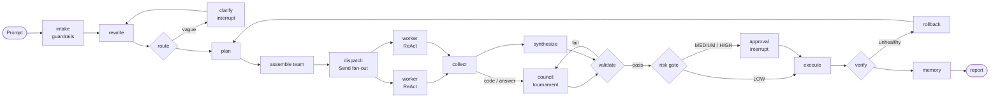

# NEXUS: a multi-agent workspace on local models

A team of 14 AI agents that plans, writes, codes, tests and asks a human before anything
risky, built on **LangGraph** with **local models (Ollama)**, **MCP tools**, **human-in-the-loop
approvals**, **checkpoints and time travel**, and a live UI where every animation is a real
backend event. Week 4 assignment (Agentic systems, state machines and MCP), AI Engineering
Bootcamp.


**What you can ask it**

| Mission | Example | What you get |
|---|---|---|
| Web page | "Build an HTML page with a blog about AI" | A styled page, published with a link and a live preview |
| Question | "When should a team prefer optimistic locking?" | A council answer: 3 agents, anonymous review, a judge |
| Fix service | Switch on a bug in the Chaos Lab | The bug found, fixed with tests, approved, applied and verified on live traffic |
| Build API | "Build a FastAPI API to manage books (title, author, year)" | A tested project as a zip |
| New ticket / Solve ticket | "Create a ticket for the slow inventory check" / "Solve ticket T-101" | A filed bug report, or a fix with tests posted to the ticket |
| Custom team | Anything else | The Commander designs a team; you approve it first |

Add "…and send the output to name@example.com" to any prompt to get the result by email.

---

## Quick start

**Needs:** macOS or Linux, Python 3.12 with [uv](https://docs.astral.sh/uv/), Node 22 with
pnpm (via corepack), and [Ollama](https://ollama.com/download). 16 GB RAM is enough.

```bash
git clone https://github.com/VinayBot/nexus.git && cd nexus
make setup            # backend deps (uv), frontend deps (pnpm), creates .env from .env.example
make models           # pulls llama3.2:3b + nomic-embed-text (the "lite" profile, ~2.3 GB)
make dev              # backend http://127.0.0.1:8000 · app http://localhost:3000
```

Open http://localhost:3000 → **Enter Command Center** → create the **owner account** (first
run only) → type a mission → **Start mission**.

Recommended models: in **Settings → Models** pick **Balanced** (Qwen2.5 3B + Qwen2.5-Coder
3B, ~5 GB), or `ollama pull qwen2.5:3b qwen2.5-coder:3b` first. **Standard (7B)** downloads
from the same screen when you want it.

<details>
<summary>Other ways to run</summary>

```bash
make prod                       # optimised frontend build + backend without the reloader
make check                      # everything CI runs: lint, mypy --strict, tsc, all tests
make e2e                        # Playwright end-to-end tests (own servers on :8011/:3011)
docker compose up --build       # backend + frontend + Mailpit; Ollama stays native on the host
NEXUS_LLM_PROVIDER=simulation make dev   # no models needed: scripted, clearly labelled
```
</details>

### Configuration

All settings are `NEXUS_*` environment variables in `.env` (see [.env.example](.env.example)).
The important ones:

| Variable | Default | Meaning |
|---|---|---|
| `NEXUS_MODEL_PROFILE` | `lite` | `lite`, `balanced` or `standard`; Settings → Models switches it live |
| `NEXUS_AUTH_ENABLED` | `true` | accounts and roles; `false` only for throwaway demos |
| `NEXUS_BOOTSTRAP_USERS` | – | seed accounts: `alice:password:owner,bob:password:operator` |
| `NEXUS_SECRET_KEY` | generated | signs sessions and approval links; a weak value is replaced by a random key |
| `NEXUS_SANDBOX_BACKEND` | `docker` | `docker` (isolated, no network) or `local` (subprocess, dev only) |
| `NEXUS_GOOGLE_CLIENT_ID/SECRET` | – | "Sign in with Google" to send result emails (or paste them in Settings) |

---

## How a mission works



1. **Quill** rewrites the prompt; keyword rules or the fast model **route** it to a playbook.
2. **Sage** writes a typed plan; the **Commander** assigns each step to the best agent by
   reputation and **dispatches** them in parallel with `Send`.
3. Each worker runs a **ReAct** subgraph with its own MCP tool allowlist.
4. For code and hard questions, **Blaze, Volt and Frost** compete: each patch is tested in a
   sandbox, reviews are anonymous, and the judge **Arbiter** weighs test results most.
5. **Aegis** validates; failures loop back (bounded by guards).
6. A **rule-based risk score** decides: run, ask a human (`interrupt()`), rehearse first, or block.
7. Execute → verify (live traffic for the demo service) → roll back if needed → remember → report.

Every step is checkpointed in SQLite, so missions survive restarts and can be rewound
(Time Travel). Details: [docs/ARCHITECTURE.md](docs/ARCHITECTURE.md) and the design
decisions in [docs/adr/](docs/adr/).

## Week 4 syllabus coverage

| Day | Topic | Where |
|---|---|---|
| 16 | ReAct · Plan-and-Execute · raw SDK loop with **native tool calling** · conditional routing | `graph/subgraphs/react_worker.py`, `graph/nodes/planning.py`, `llm/raw_react_agent.py` |
| 17 | Typed state · reducers · conditional edges · guarded cycles · `Send` fan-out · subgraphs · `Command` | `graph/state.py`, `graph/reducers.py`, `graph/main_graph.py` |
| 18 | SQLite checkpointing · crash resume · sliding-window and summary pruning · token budgets · long-term memory | `core/runtime.py`, `graph/runner.py`, `memory/` |
| 19 | Supervisor routing · worker delegation · **7 MCP servers** (in-process and **stdio**) | `graph/nodes/work.py`, `mcp_servers/` |
| 20 | `interrupt()` approval gates · email approvals · time travel and forking · guardrails · **RBAC** | `graph/nodes/gate.py`, `hitl/`, `safety/`, `auth/` |

The full map, with the test that proves each item: [docs/TOPIC_COVERAGE.md](docs/TOPIC_COVERAGE.md).

## Security

- **Accounts and roles.** Argon2id password hashes, JWT sessions, login rate limit
  (5 per minute per user and address). One policy table ([auth/policy.py](backend/nexus/auth/policy.py))
  guards every route:

  | Role | Can |
  |---|---|
  | Viewer | read everything |
  | Operator | + start and cancel missions, approve or reject, time travel |
  | Owner | + settings, models, users, chaos switches, agents, deleting missions |

  Approvals record the signed-in user, never a name sent by the client. Public by design:
  health probes, sign-in, signed one-time email-approval links, the Google OAuth callback and
  published pages.
- **Agents are boxed in.** Per-agent MCP tool allowlists, a workspace path jail, a sandbox
  with no network for tests, prompt-injection detection, secret and PII redaction, and
  fencing of untrusted text.
- **Email** goes out only when a prompt asks for it, through Sign in with Google with the
  `gmail.send` scope only (NEXUS never sees the password and cannot read mail).
- **Secrets** stay in `.env` and `backend/data/` (both ignored by git and Docker).

## Reliability and observability

Model fallback chain (primary → alternate → reduced context), circuit breakers, retries with
jitter, schema-constrained structured output with re-prompts, a per-mission token cap, and a
**Resource Governor** that lowers LLM concurrency under memory pressure instead of crashing.
`GET /metrics` serves Prometheus metrics (missions, tokens, approvals, emails, RAM,
concurrency, queue, tokens/s, circuit breakers); traces and benchmarks are in **Insights**.

## Tests and quality

| Suite | Count | Command |
|---|---|---|
| Backend (pytest; scripted model, real SQLite, MCP, sandbox, demo service) | 119 | `make test-backend` |
| Frontend unit (vitest) | 13 | `make test-frontend` |
| End-to-end (Playwright; auth on, Simulation provider) | 25 | `make e2e` |
| Lint and types | ruff · mypy --strict · eslint · prettier · tsc strict | `make check` |

CI runs all of them on every push ([.github/workflows/ci.yml](.github/workflows/ci.yml)).
Live-model tests are marked `@pytest.mark.live`.

**Verified live** on a 16 GB Mac (Balanced profile): every mission type end to end, e.g. a
blog page published in 55 s, a self-heal that fixed a bad tax setting (10/10 tests, 99 live
orders, 0 errors), tickets filed and solved, and email results delivered with an approval
clicked from the email itself.

## Known limitations

- 3B local models sometimes need a second round of work; the guarded fix loops handle it.
- Build API is scoped to small services (8 files or fewer).
- Without Docker the sandbox is a plain subprocess (labelled "not isolated" in the UI).
- Links inside result emails point to the machine running NEXUS.
- One node: SQLite for state, an in-process rate limiter, no horizontal scaling.

## Repository layout

```
backend/            FastAPI + LangGraph (Python 3.12, uv)
  nexus/graph/      the main graph, nodes, ReAct and tournament subgraphs, runner
  nexus/playbooks/  mission types (web page, self-healing, tickets, builder, council, dynamic)
  nexus/llm/        gateway, router, Ollama provider, raw SDK agent, model profiles
  nexus/mcp_servers/ 7 MCP servers + hub
  nexus/hitl/       approvals, email approvals, time travel, result emails, Google mail
  nexus/auth/       roles, policy table, sessions, rate limit
  nexus/safety/     guardrails, risk scoring, policies
  tests/            pytest suites
frontend/           Next.js 15 + TypeScript (strict), Tailwind v4, Playwright e2e
demo-service/       the FastAPI shop the self-healing missions repair
docs/               architecture, ADRs, topic coverage, mission guide, demo scripts
```

More: [mission guide](docs/HOW_IT_WORKS.md) · [code walkthrough](docs/CODE_WALKTHROUGH.md) ·
[presentation guide](docs/PRESENTATION_GUIDE.md).
