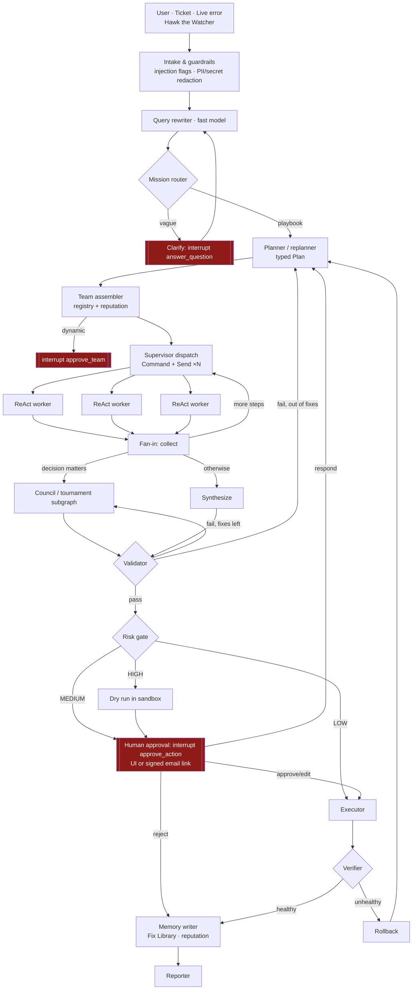

# NEXUS architecture

NEXUS is a multi-agent orchestration system built on **LangGraph** and **local open
models (Ollama)**. It has automated retries, **SQLite persistence** and **human approval
gates**. The UI (Next.js) animates the system from real backend events only, and every API
route is guarded by accounts and roles (owner, operator, viewer; see `backend/nexus/auth/`).

## 1. Request flow

Every node emits typed events to an in-process bus. The bus fans them out to
WebSockets (live UI) and batches them into SQLite (replay). Every super-step is
checkpointed by `AsyncSqliteSaver`, which powers time travel and crash resume.

## 2. Components

| Layer | Module | Responsibility |
|---|---|---|
| API | `nexus/api/*` | REST `/api/v1`, WebSockets `/ws/missions/{id}` and `/ws/global` (backlog replay from `after_seq`), SSE for the guide |
| Runtime | `nexus/core/runtime.py` | Builds every long-lived service in order: DB, Chroma, MCP hub, checkpointer, graph, runner, approvals, time travel, email approvals |
| Runner | `nexus/graph/runner.py` | One LangGraph thread per mission; turns checkpoints into events; records interrupts; `resume()`, `cancel()`, and `recover()` on startup |
| Orchestrator | `nexus/graph/main_graph.py`, `nodes/*` | 20 instrumented nodes, conditional edges, guarded cycles, `RetryPolicy` on LLM-heavy nodes |
| Subgraphs | `graph/subgraphs/react_worker.py`, `tournament.py` | ReAct worker (`think ⇄ act`, iteration guard). Council (propose → ground → mask → review → converge ⟲ revise → judge) |
| State | `graph/state.py`, `graph/reducers.py` | `MissionState` (JSON-safe dicts) with custom reducers `merge_dict`, `merge_scores`, `dedupe_append`, `sum_counts`, `add_messages` |
| LLM | `nexus/llm/*` | `LLMProvider` (Ollama, scripted), model router, gateway (governor slot, breaker, retries, fallback chain, structured output, token streaming), raw-SDK ReAct agent |
| Reliability | `nexus/reliability/*` | tenacity retries with events, JSON repair, circuit breakers |
| Governor | `nexus/core/governor.py` | Adaptive concurrency from free memory (queues instead of failing), per-model limits, tokens/sec, metrics events |
| Memory | `nexus/memory/*`, `core/meter.py` | Sliding-window and summarisation pruning, calibrated token estimates, per-mission token cap, ChromaDB long-term memory with a PCA map |
| MCP | `nexus/mcp_servers/*` | Seven `MCPServer`s reached through MCP `Client`s (in-memory transport); allowlists, path jail, system-only `notify`, call log |
| Safety | `nexus/safety/*` | Risk scorer, YAML policy engine, guardrails (injection detection, redaction, fencing of untrusted text) |
| HITL | `nexus/hitl/*` | Approvals + audit, signed single-use email tokens, Mailpit mailer with outbox fallback, time travel |
| Playbooks | `nexus/playbooks/*` | Self-Healing, Ticket Solver, Project Builder, Council Q&A, Dynamic, and saved YAML playbooks; the demo-service and the watcher |
| Observability | `core/tracing.py`, `api/routes_insight.py` | OpenTelemetry spans (mission → node → llm/tool) exported to SQLite; summaries, logs, evals |
| Guide | `nexus/guide/nova.py` | RAG over the project docs plus a read-only live-state snapshot; rule-based UI actions |

The frontend (`frontend/src`) mirrors this design. `lib/missionView.ts` is a pure reducer
from events to a view model, and `lib/robotMachine.ts` maps events to robot animation
states. Live mode (WebSocket) and Replay mode (persisted events at 0.5–8×) feed the
same reducer.

## 3. Design decisions worth reading

The ADRs in `docs/adr/` explain the choices in more detail.

### Evidence-grounded tournaments beat pure LLM debate

The three Challengers share **one model**. They differ only in persona, strategy and
temperature, so they also share that model's blind spots. A debate between three copies
of the same misconception tends to converge on it confidently. NEXUS therefore makes
**evidence** the largest term in the judge's score:

- In code mode, every patch is applied to its own throwaway copy of the workspace and
  the full test suite runs in the sandbox. This includes the reproduction test, which is
  kept only if it *fails* on the buggy code.
- Test results are independent of the model. They break ties objectively, and they
  catch the confident-but-wrong answer that peer review misses.
- Peer review is anonymised (labels shuffled), so reviewers judge content, not authorship.
- The judge computes a weighted score: tests 0.45, peer 0.25, critic risk 0.10, diff
  size 0.10, reputation 0.10. It reports confidence and the strongest dissent.
- A failing winner, low confidence or high disagreement **escalates** to a human.

Live example from the first real heal run (llama3.2:3b): Frost's first patch,
`order.get("email") or ""`, was reviewed favourably but broke e-mail normalisation, and
9/10 tests caught it. Round 2, informed by the failing-test feedback, produced
`order.get('email') and order.get('email').strip().lower() or ''`. It passed all 10
tests and healed the live service.

### Small-model engineering

NEXUS runs on a 3B model by default (`lite` profile). Several deliberate choices make
that workable:

- **Schema-constrained outputs.** Ollama `format=<json schema>` for every structured
  output. ReAct workers use native tool calling or JSON turns per model (`auto`, from a
  measured benchmark), recover calls the model printed as text, and fall back to a
  schema-constrained JSON turn on an empty reply.
- **Validation re-prompts** that quote the exact Pydantic error, escalation to the main
  model, then a safe default.
- **Line-range edits.** The solver returns `start_line`/`end_line`/`replacement` over a
  numbered file, and NEXUS builds the exact search block. 3B models copy code badly but
  rewrite lines well.
- **A traceback focus line.** When a traceback pins the failure, solvers see only that
  file plus the exact failing line.
- **Output-token caps** on structured calls. A runaway generation otherwise burns the
  whole 180 s timeout.
- **Tolerant patch application:** exact, then whitespace-tolerant, then a single line.
  Anything ambiguous is rejected with a reason, never guessed.

## 4. Persistence

| Store | File | Contents |
|---|---|---|
| Checkpoints | `data/checkpoints.db` | LangGraph `AsyncSqliteSaver`, one thread per mission |
| App DB | `data/nexus.db` | missions, events, approvals, used tokens, audit, dead letters, agent stats, tool calls, outbox, tickets, incidents, branches, guide messages, eval runs, trace spans |
| Long-term memory | `data/chroma/` | `fix_library`, `missions`, `docs`, `lessons` |
| Workspaces | `data/workspaces/<mission>/` | Per-mission copies (path-jailed) |
| Live service | `data/demo-live/` | git repo served by `uvicorn --reload`; fix branches `nexus/fix-<mission>` |

## 5. Safety model

- **Untrusted text** (tickets, documents, logs, tool output) is fenced by
  `guardrails.fence()`, scanned for injection patterns and redacted.
- **Tool allowlists per agent.** The `notify` server is system-only, so no agent can
  send e-mail. E-mail goes out only after an approved action.
- **The path jail** rejects absolute paths, `..` escapes and symlinks out of the workspace.
- **The sandbox** runs on a copy of the workspace. With Docker it has no network, 1 CPU,
  512 MB, a pids limit and a timeout. Without Docker it falls back to a subprocess that
  is **labelled "local (not isolated)" in every result**.
- **The risk gate** routes LOW to auto, MEDIUM to approval, HIGH to dry-run plus
  approval, and blocks CRITICAL unless overridden with a written reason. Policies can
  only make a route stricter.
- **E-mail approvals** use signed, expiring, single-use tokens. GET shows a confirmation
  page and only POST decides, so link prefetchers can never approve anything.
