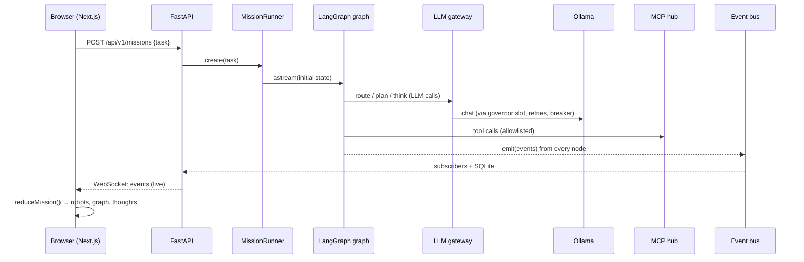

# How NEXUS works: a learning guide

This guide teaches you how NEXUS works from the inside, so you understand every part
well enough to explain it, change it, or rebuild it. It complements
[PRESENTATION_GUIDE.md](PRESENTATION_GUIDE.md), which is about *presenting*. This one
is about *learning*.

**How to read it**

1. Read **Part A** (basic concepts) if any term is new. Skip what you already know.
2. Read **Part B** (follow one mission). This is the heart of the guide: it follows a
   single mission from the moment you click **Begin mission** to the moment a robot
   celebrates. Each stop shows the real code (shortened) and explains it.
3. Parts C–G go deeper into the subsystems: events and the UI, persistence and time
   travel, memory, safety, and self-healing.
4. **Part H** has hands-on exercises. Doing them is the fastest way to really learn.
5. **Part I** is a glossary; **Part J** is the order in which to read the code.

All code excerpts are from this repo, slightly shortened (`…` marks cuts). Paths are
relative to `backend/nexus/` unless they start with `frontend/`.

---

## Part A: The basic concepts, from zero

### A1. LLM, tokens and the context window

- **LLM (large language model):** a program that continues text. Give it messages, and
  it writes a reply. NEXUS uses **llama3.2:3b**, a 3-billion-parameter open model that
  runs on your laptop through **Ollama** (a local model server on port 11434).
- **Token:** the unit an LLM reads and writes, roughly ¾ of a word. Speed and limits are
  measured in tokens.
- **Context window:** the maximum number of tokens the model can read at once (NEXUS uses
  8,192). Everything (instructions, history, tool results) must fit inside it. That is
  why we need **pruning** (Part E).
- **Temperature:** randomness. 0.1 gives nearly the same answer every time; 0.7 gives
  more variety. The three tournament solvers use different temperatures on purpose.

### A2. Agent, tool and ReAct

- **Agent:** an LLM given a role (a system prompt), tools, and a loop that lets it act
  more than once.
- **Tool:** a function the agent may call, for example "read this file" or "run the
  tests". The agent doesn't run code itself; it *asks* for a tool call, our program runs
  it, and the result is shown back to the agent.
- **ReAct:** the standard agent loop: **Re**ason (think) → **Act** (call a tool) →
  observe the result → repeat until done.

### A3. Graph, state, node, edge (LangGraph)

- **LangGraph** describes a workflow as a **graph**:
  - **nodes** are steps (Python functions);
  - **edges** say which step comes next;
  - **conditional edges** choose the next step with a function;
  - the **state** is a dictionary every node reads, and returns updates to.
- **Super-step:** one "tick" of the graph. All nodes scheduled together run, then their
  updates are merged.
- **Reducer:** the rule for merging updates into one state key. The default is
  "overwrite"; a reducer can say "append" or "merge by id" instead. That is essential
  when nodes run in parallel.
- **`Send`:** launches the same node several times in parallel with different inputs
  (fan-out).
- **`Command`:** a node's return value that says *both* "update the state" and "go to
  this node next".
- **Checkpoint:** a saved copy of the state after a super-step. LangGraph writes one
  through a **checkpointer** (we use SQLite).
- **`interrupt()`:** pauses the graph inside a node and waits for outside input (a
  human). `Command(resume=value)` continues it.

### A4. Embeddings and a vector database

- **Embedding:** a list of numbers (a vector) representing the *meaning* of a text.
  Similar meanings give vectors that are close together. NEXUS makes them with
  `nomic-embed-text`.
- **Vector database (ChromaDB):** stores texts with their embeddings and finds "the
  closest meanings" to a query. This is **semantic search**, used for long-term memory
  and RAG.
- **RAG (retrieval-augmented generation):** first search your documents, then give the
  results to the LLM so it answers from facts instead of guessing.

### A5. MCP (Model Context Protocol)

- **MCP** is a standard protocol for tools.
  - A **server** describes its tools (name, description, JSON schema of inputs) and runs
    them.
  - A **client** lists and calls them.
- Because it is a standard, the same tool server works with NEXUS, Claude Desktop, IDEs,
  and so on.

### A6. WebSocket and SSE

- **WebSocket:** a connection that stays open, so the server can *push* messages to the
  browser at any time. NEXUS streams every event this way.
- **SSE (server-sent events):** a simpler one-way stream over HTTP. Nova's answers use
  it to stream text.

---

## Part B: Follow one mission end to end

We'll follow the mission *"What is the difference between ReAct and Plan-and-Execute
agents?"* with **Let the Commander decide**. Here is the whole journey; each numbered
stop is explained below.



### Stop 1: the browser starts the mission

`frontend/src/components/mission/MissionComposer.tsx` sends:

```ts
post<Mission>("/missions", { task: text, playbook: playbook || null, inputs })
```

and then navigates to `/missions?m=<new id>`.

### Stop 2: the runner creates and starts it (`graph/runner.py`)

```python
async def create(self, task, *, playbook=None, inputs=None, …) -> MissionRow:
    mission_id = uuid.uuid4().hex[:12]
    row = MissionRow(id=mission_id, title=…, task=task, status="queued", …)
    async with self.db.session() as s:
        s.add(row)                                  # 1) save the mission row
    emit("mission.created", MissionCreated(…), mission_id=mission_id)   # 2) first event
    initial = {"mission_id": mission_id, "task": task, "title": row.title, "inputs": inputs}
    self.start(mission_id, initial)                 # 3) run in a background asyncio task
    return row
```

The HTTP request returns immediately. The mission runs in the background, in
`_drive()`:

```python
async def _drive(self, mission_id, payload, *, resumed, checkpoint_id):
    ctx = MissionContext(mission_id=mission_id, thread_id=mission_id)
    token = mission_context.set(ctx)        # every emit() below knows its mission
    …
    async for chunk in self.graph.astream(payload, config, stream_mode="checkpoints"):
        ctx.checkpoint_id = chunk["config"]["configurable"]["checkpoint_id"]
        emit("checkpoint.saved", CheckpointSaved(checkpoint_id=…, step=…, next=…))
    await self._settle(mission_id)          # paused for a human, or completed?
```

**Learn:**
- **Thread:** the `thread_id` is the mission id. LangGraph keeps one checkpoint history
  per thread, which is how a mission can be resumed or time-travelled later.
- **Context variables:** `mission_context` is a Python `ContextVar`. asyncio copies it
  into every task LangGraph spawns, so even parallel workers emit events tagged with the
  right mission, without passing ids around.
- **Checkpoint streaming:** `stream_mode="checkpoints"` yields after each super-step, and
  each one becomes a `checkpoint.saved` event (the hexagons in Time Travel).

### Stop 3: the graph itself (`graph/main_graph.py`)

```python
def build_graph(checkpointer=None):
    g = StateGraph(MissionState)
    for name, fn in NODES.items():
        retry = LLM_RETRY if name in RETRIED else None
        g.add_node(name, instrument(name, fn, …), retry_policy=retry,
                   destinations=("worker", "collect") if name == "dispatch" else None)
    g.add_edge(START, "intake")
    g.add_edge("intake", "rewrite")
    g.add_edge("rewrite", "route")
    g.add_conditional_edges("route", understand.after_route, ["clarify", "plan"])
    g.add_edge("plan", "assemble")
    g.add_conditional_edges("assemble", planning.after_assemble, ["dispatch", "report"])
    g.add_edge("worker", "collect")
    g.add_conditional_edges("collect", work.after_collect, ["dispatch", "council", "synthesize"])
    …
    g.add_conditional_edges("risk_gate", gate.after_gate, ["execute", "approval", "dry_run"])
    …
    g.add_edge("report", END)
    return g.compile(checkpointer=checkpointer, name="nexus")
```

Things to notice:

1. **`instrument(name, fn)` wraps every node.** That wrapper is what makes the UI live
   (Part C).
2. **`RetryPolicy`:** fragile LLM-heavy nodes (rewrite, route, plan, worker, council,
   synthesize, validate) are retried by LangGraph itself if the model is unavailable.
   This is reliability **layer 2**; layer 1 is inside the gateway (Stop 9).
3. **`destinations`:** `dispatch` returns `Command(goto=[Send…])` instead of using an
   edge, so the graph is told where it may go, for drawing and validation.
4. **One graph for every playbook.** Playbooks plug in through hooks (Stop 15).

**The shared state** (`graph/state.py`) is a `TypedDict`. The keys that parallel nodes
write to have a reducer attached with `Annotated`:

```python
class MissionState(TypedDict, total=False):
    task: str
    playbook: str
    plan: dict[str, Any] | None
    findings:     Annotated[list[dict[str, Any]], append_list]   # many workers append
    step_results: Annotated[dict[str, Any], merge_dict]          # keyed by step id
    proposals:    Annotated[dict[str, Any], merge_dict]          # keyed by solver id
    scores:       Annotated[dict[str, Any], merge_scores]        # reviews accumulate
    evidence:     Annotated[list[dict[str, Any]], dedupe_append] # no duplicate evidence
    loops:        Annotated[dict[str, int], sum_counts]          # loop guard counters
    verdict: dict[str, Any] | None
    risk: dict[str, Any] | None
    …
```

Keys without a reducer (such as `plan`) are simply overwritten by the latest update.

### Stop 4: intake → rewrite → route (`graph/nodes/understand.py`)

- **`intake`** runs the **guardrails** on the user's text: it redacts secrets and
  personal data and flags prompt-injection phrases (Part F).
- **`rewrite`** (Quill) restates the task clearly as a structured `RewrittenTask`. It
  uses the *fast* model role, because it is a light job.
- **`route`** (the Commander) picks the playbook. If you chose one in the UI, that wins.
  Otherwise rules and keywords decide, with the model as a fallback. A vague task goes
  to **`clarify`**, which calls `interrupt()` to ask you a question, then loops back to
  `rewrite` (guarded: at most 2 times).

Every routing function ends with `take(source, target, label)`. That helper emits
`edge.taken`, which is why the Live Graph flashes the branch label.

### Stop 5: plan → assemble (`graph/nodes/planning.py`)

- **`plan`** (Sage) returns a typed `Plan`: a goal plus `PlanStep`s with ids, roles and
  `depends_on`. Some playbooks (Self-Healing, for example) use a **template plan**
  instead of asking the model, because a 3B model plans unreliably and the steps are
  known.
- **`assemble`** (the Commander) picks an agent for each step from the registry, using
  **reputation**. For Dynamic missions it calls `interrupt()` so you approve the team
  first.

### Stop 6: dispatch, the fan-out with `Send` (`graph/nodes/work.py`)

```python
async def dispatch(state) -> Command[str]:
    p = Plan.model_validate(state["plan"])
    done = set((state.get("step_results") or {}).keys())
    ready = p.ready_steps(done)                 # steps whose dependencies are done
    if not ready or count(state, "dispatch") >= limit(state, "dispatch"):
        return Command(goto="collect", update={…})     # nothing to do, or guard tripped
    sends = []
    for step in ready:
        agent_id = _owner(team, step.id)
        tools = …  # playbook defaults ∩ the agent's own allowlist
        emit("handoff", Handoff(source="commander", target=agent_id, reason=step.title))
        sends.append(Send("worker", {"agent_id": agent_id, "step": step.model_dump(),
                                     "tools": tools, "max_iterations": …, …}))
    emit("send.fanout", SendFanout(source="dispatch", target="worker", count=len(sends), …))
    return Command(goto=sends, update={"loops": {"dispatch": 1}, …})
```

**Learn:**
- **Two jobs in one return:** `Command(goto=sends, update=…)` routes *and* updates state
  atomically.
- **Parallel runs:** each `Send("worker", payload)` creates one parallel run of the
  `worker` node with its own input (not the whole state).
- **Animation trigger:** the `handoff` event is what makes a data orb fly from the
  Commander to that robot.
- **Guard counter:** `{"loops": {"dispatch": 1}}` adds 1 to the dispatch counter through
  the `sum_counts` reducer.

### Stop 7: the worker runs a ReAct subgraph (`graph/subgraphs/react_worker.py`)

The worker builds the step's instructions, then runs the **ReAct subgraph**:

```python
def build_react_worker():
    g = StateGraph(WorkerState)
    g.add_node("think", think)
    g.add_node("act", act)
    g.add_node("finalize", finalize)
    g.add_edge(START, "think")
    g.add_conditional_edges("think", after_think, ["act", "finalize", END])
    g.add_edge("act", "think")                  # the ReAct cycle
    g.add_edge("finalize", END)
    return g.compile(checkpointer=False, name="react_worker")

def after_think(state):
    if state.get("final") is not None:
        return END                              # the agent answered
    if state.get("iteration", 0) >= state.get("max_iterations", 5):
        return "finalize"                       # the iteration guard
    return "act"
```

**`think`** asks the model for **one structured turn**. The schema is generated per
agent, so the model can only name tools it is allowed to use:

```python
def _turn_schema(tool_names):
    actions = (*tool_names, "final")
    return create_model("ReActTurn",
        thought=(str, …),
        action=(Literal[actions], …),          # only allowed tools, or "final"
        action_input=(dict[str, Any], …),
        final_answer=(str | None, …))

async def think(state):
    pruned = await prune(messages, budget, strategy=svc.settings.pruning_strategy, …)  # Part E
    turn = await svc.llm.structured(pruned.messages, _turn_schema(tool_names),
                                    purpose="react", agent_id=spec.id, temperature=spec.temperature)
    emit("agent.thinking", AgentThinking(agent_id=spec.id, text=turn.thought, …))
    if turn.action == "final":
        emit("agent.final", …)
        update["final"] = answer
```

**`act`** runs the tool and appends the **fenced** observation:

```python
async def act(state):
    tool, args = …  # from the last turn
    emit("agent.action", AgentAction(agent_id=spec.id, tool=tool, args=args, …))
    outcome = await svc.toolbox.call(tool, args, agent_id=spec.id, allowlist=state["tools"])
    emit("agent.observation", AgentObservation(…, ok=outcome.ok))
    observation = ChatMessage.user(f"Observation from {tool}:\n{fence(outcome.text, source=tool)}")
```

**Why structured turns?** Small models are unreliable with free-text "Thought:/Action:"
formats and with native tool-calling. A JSON schema (enforced by Ollama's `format`
option) plus validation makes every turn parseable, and if it isn't, the gateway
re-prompts (Stop 10).

**Why `fence()`?** Tool output is untrusted. It could contain "ignore your instructions".
Wrapping it in labelled delimiters, which the system prompt says never to obey, defuses
that (Part F).

### Stop 8: a tool call travels through MCP (`mcp_servers/hub.py`)

```
agent → toolbox.call("workspace.read_file", args, agent_id, allowlist)
      → MCPHub.call(): is it a system-only server? blocked for agents (emits guardrail.triggered)
                       is it on the agent's allowlist? otherwise refused
                       inject the hidden "workspace" argument (the path jail root)
      → MCP Client (in-memory transport) → MCPServer "workspace" → read_file()
      → result + tool.called/tool.result events + a row in tool_calls (the call log)
```

```python
SYSTEM_ONLY = {"notify"}          # agents may never send email directly

async def call(self, name, args, *, agent_id, allowlist, workspace=None):
    meta = self.tools.get(name)
    if meta and meta["server"] in SYSTEM_ONLY and agent_id is not None:
        emit("guardrail.triggered", GuardrailTriggered(kind="policy",
             detail=f"{agent_id} tried {name}: system-only (approval required)", action="blocked"))
        …
```

**Learn:**
- **Hidden parameters:** the agent never sees the `workspace` parameter (`HIDDEN_PARAMS`
  removes it from the schema shown to the model). NEXUS fills it in, so an agent cannot
  point a file tool outside its mission folder.
- **Full protocol in-process:** the MCP client uses the SDK's *in-memory transport*. You
  get the real protocol (initialise, `tools/list`, `tools/call`) without starting a
  subprocess for every call.

### Stop 9: an LLM call travels through the gateway (`llm/gateway.py`)

Every model call in NEXUS goes through `LLMGateway.complete()`:

```python
async def complete(self, messages, *, purpose, role=None, agent_id=None, …):
    meter.check(mission_id)                              # 1) token cap: stop if over budget
    _, primary = self.router.pick(purpose, role=role)    # 2) fast or main model?
    base = LLMRequest(model=primary, messages=messages, …)
    chain = [("primary", base)]                          # 3) the fallback chain
    if self.fallback_model and self.fallback_model != primary:
        chain.append(("alternate model", base.model_copy(update={"model": self.fallback_model})))
    if len(messages) > 3:
        chain.append(("reduced context", base.model_copy(update={"messages": reduce_context(messages)})))
    for i, (label, req) in enumerate(chain):
        if i > 0:
            emit("retry", Retry(layer="fallback", …))    # visible in the UI
        try:
            result = await self._call_model(req, stream, on_token)
        except (ProviderError, CircuitOpenError, TimeoutError) as exc:
            last_exc = exc
            continue                                     # try the next link in the chain
        self._account(req, result, estimated)            # tokens, calibration, llm.call event
        return result
    raise LLMUnavailableError(…)
```

And one attempt against one model:

```python
async def _call_model(self, request, stream, on_token=None):
    breaker = self.breakers.get(f"model:{request.model}")
    breaker.before_call()                    # raises immediately if the circuit is OPEN
    async def attempt():
        async with self.governor.slot(request.model):        # wait for a free slot (RAM-aware)
            async with asyncio.timeout(self.timeout_s):      # never hang forever
                return await self.provider.chat(request, on_token=callback)
    try:
        result = await with_retries(attempt, key=f"model:{request.model}", …)  # 3 tries, backoff + jitter
    except Exception:
        breaker.on_failure()
        raise
    breaker.on_success()
    return result
```

Read from the outside in, this is the **reliability onion**:

| Layer | What it handles |
|---|---|
| Token cap (`core/meter.py`) | A runaway mission is stopped before it costs more. |
| Model router (`llm/router.py`) | Light jobs (rewrite, grade, summarise) go to the *fast* role; plan, solve and judge go to *main*. After repeated validation failures, a fast job is moved to *main*. |
| Fallback chain | primary → alternate model → the same call with **reduced context** (only the last turns). |
| Circuit breaker (`reliability/circuit_breaker.py`) | After **3** failures the model's circuit is **open** for **20 s**: calls fail instantly instead of piling up. Then one trial call is allowed (half-open); success closes it. |
| Retries (`reliability/retry.py`) | Up to **3** attempts with exponential backoff and jitter; each emits a `retry` event (the robot's RGB glitch). |
| Governor slot (`core/governor.py`) | Waits until a call slot is free (Stop 9b). |
| Timeout | Each attempt is capped (180 s). |

#### Stop 9b: the Resource Governor (`core/governor.py`)

```python
@property
def limit(self) -> int:
    if self._pressure == "critical":
        return 1                                   # one call at a time
    if self._pressure == "elevated":
        return max(1, self.configured_limit // 2)  # half the concurrency
    return self.configured_limit

@contextlib.asynccontextmanager
async def slot(self, model):
    async with self._cond:
        await self._cond.wait_for(lambda: self._admissible(model))   # queue here
        self._in_flight += 1
    try:
        yield
    finally:
        async with self._cond:
            self._in_flight -= 1
            self._cond.notify_all()                # wake the next waiting call
```

A background loop samples free RAM every 2 s (with `psutil`) and sets the pressure level.
Calls never fail because of memory: they **wait**. That is what keeps a 16 GB Mac
responsive.

### Stop 10: structured output with a re-prompt (`LLMGateway.structured`)

```python
for attempt in range(1, attempts + 1):           # 1 try + 2 re-prompts
    result = await self.complete(convo, json_schema=schema.model_json_schema(), …)
    try:
        return schema.model_validate(extract_json(result.content))   # parse, repair, validate
    except (JsonRepairError, ValidationError) as exc:
        emit("retry", Retry(layer="validation", …))
        convo = [*convo, ChatMessage.assistant(result.content[:2000]),
                 ChatMessage.user(f"Your previous reply was not valid. Error:\n{error}\n"
                                  f"Reply with ONLY a JSON object matching this schema:\n{schema}")]
if default is not None:
    return default                               # a safe default instead of crashing
raise StructuredOutputError(…)
```

**Learn:** the model sees its own mistake and the exact validation error, which fixes
most small-model formatting slips. `extract_json` repairs near-misses (code fences,
trailing commas). A `default` lets non-critical steps degrade gracefully.

### Stop 11: collect, the fan-in with reducers (`graph/reducers.py`)

When the parallel workers finish, LangGraph merges their returned updates with the
reducers:

```python
def merge_dict(left, right):
    """keys in right overwrite left; a None value deletes; {"__reset__": True} starts empty"""
    …

def dedupe_append(left, right):
    """append evidence items, skipping any whose hash is already present"""
    out = list(left or [])
    seen = {item.get("hash") for item in out}
    for item in right or []:
        h = item.get("hash")
        if h and h in seen:
            continue
        seen.add(h)
        out.append(item)
    return out

def sum_counts(left, right):
    """add per-key counters; a negative value resets that counter"""
```

**Worked example:**
- Two workers each return `{"evidence": [item]}`, and both read the same log line. Both
  items have the same hash, so `dedupe_append` keeps one.
- Each worker also returns `{"step_results": {"s1": …}}` or `{"step_results": {"s2": …}}`.
  `merge_dict` keeps both.
- Without reducers, the second worker's update would simply overwrite the first.

`collect` then decides via `after_collect`:
1. more steps are ready → loop back to `dispatch` (guarded);
2. the playbook uses a tournament → `council`;
3. otherwise → `synthesize` (Quill merges the findings into one answer).

### Stop 12: the council tournament (`graph/subgraphs/tournament.py`, `scoring.py`)

The tournament is its own subgraph:

```python
g.add_conditional_edges(START, fan_out_proposals, ["propose"])  # Send ×3 solvers
g.add_edge("propose", "ground")       # code mode: run each patch's tests in the sandbox
g.add_edge("ground", "mask")          # relabel proposals A/B/C in shuffled order
g.add_conditional_edges("mask", fan_out_reviews, ["review"])    # Send × reviewers
g.add_edge("review", "converge")      # measure how much reviewers disagree
g.add_conditional_edges("converge", after_converge, ["revise", "judge"])
g.add_edge("revise", "ground")        # a debate round: revise, re-test, re-review
g.add_edge("judge", END)
```

The judge's maths is pure Python (no LLM), which makes it easy to test:

```python
WEIGHTS = {
    "code":   {"tests": 0.45, "peer": 0.25, "critic": 0.10, "size": 0.10, "reputation": 0.10},
    "answer": {"tests": 0.0,  "peer": 0.70, "critic": 0.20, "size": 0.0,  "reputation": 0.10},
}
…
confidence = 0.5 + (margin / 10) * 2.5 - div / 20
if tests_failed:
    confidence *= 0.5
escalate = confidence < 0.6 or div > divergence_threshold * 1.5 or tests_failed
```

**Worked example (code mode).** Solver C's patch passes 10/10 tests. Its scores:

| Part | Score | × Weight | = |
|---|---|---|---|
| tests (10/10) | 10 | 0.45 | 4.50 |
| peer review (mean) | 7.5 | 0.25 | 1.875 |
| critic (10 − risk 4) | 6 | 0.10 | 0.60 |
| diff size (small) | 8 | 0.10 | 0.80 |
| reputation | 5 | 0.10 | 0.50 |
| **final** | | | **8.275** |

- If the runner-up scored 7.5, the margin is 0.775.
- With reviewer divergence 1.0: confidence = 0.5 + 0.0775 × 2.5 − 0.05 ≈ **0.64**. That
  is above 0.6, so no escalation.
- If the winner's tests had failed, confidence would be halved and **always** escalated.

**Why tests carry 0.45:** the three solvers are the *same model*, so they share blind
spots and tend to like each other's answers. Test results are independent of the model.

### Stop 13: validate, and the guarded loops

`validate` (Aegis) checks the result (for code: did the winner's tests pass?).
`after_validate` routes:

| Result | Next step |
|---|---|
| pass | `risk_gate` |
| fail, with fix attempts left | `council` again, with the failing tests fed into the prompts |
| fail, out of fixes but replans left | `plan` (a new plan revision) |
| otherwise | `report` (honest failure) |

All limits live in `state.DEFAULT_LIMITS`:

```python
DEFAULT_LIMITS = {"clarify": 2, "dispatch": 8, "fix": 2, "replan": 2,
                  "verify": 2, "debate": 2, "react": 6}
```

### Stop 14: risk gate → approval interrupt → resume (`graph/nodes/gate.py`, `safety/risk.py`)

```python
async def risk_gate(state):
    action = playbook.proposed_action(state)        # e.g. apply_patch to app/orders.py
    history = await approval_history(action.kind)   # how you decided similar actions before
    risk = score_risk(action, tests=…, verdict=…, history=history, policies=services().policies)
    emit("risk.scored", RiskScored(level=risk.level, score=risk.score, factors=risk.factors, route=risk.route))
    return {"action": action.model_dump(), "risk": risk.model_dump()}
```

`score_risk` adds up explainable factors:

```python
ACTION_BASE = {"deliver_answer": 0.0, "run_team": 0.15, "comment_ticket": 0.2,
               "write_project": 0.25, "send_email": 0.3, "apply_patch": 0.35}
BLAST = {"none": 0.0, "local": 0.05, "service": 0.15, "external": 0.25}
# + files touched, diff size, tournament confidence/escalation, past decisions …
# score < 0.25 LOW → auto · < 0.5 MEDIUM → approve · < 0.75 HIGH → dry_run · else CRITICAL → blocked
```

Then policies can only make the route **stricter** (`patch_requires_approval` turns
"auto" into "approve").

The `approval` node **pauses the graph**:

```python
async def approval(state):
    raw = interrupt({                               # the graph stops here; the state is checkpointed
        "kind": "approve_action", "summary": action.summary, "risk": risk.model_dump(),
        "dry_run": …, "evidence": _approval_evidence(state), …})
    decision = ApprovalDecision.model_validate(raw)  # this line runs only after resume
    …
```

What happens next:

1. **The run pauses.** `astream` finishes, and `_settle()` sees `snapshot.interrupts`. It
   marks the mission `paused`, records an **approval** row, emits `interrupt.raised`, and
   (if configured) emails you.
2. **You decide.** You click Approve. The API calls `runner.resume(mission_id,
   decision)`, which starts the graph again with `Command(resume=decision)`.
3. **LangGraph re-enters `approval`.** This time `interrupt()` *returns* your decision
   instead of pausing.

> **Remember:** the code before `interrupt()` in a node runs twice (once before pausing,
> once on resume), so it must be safe to repeat.

### Stop 15: execute → verify → rollback, through playbook hooks (`playbooks/`)

The main graph calls hooks on the mission's playbook (`playbooks/base.py`):

| Hook | Job |
|---|---|
| `template_plan` | A fixed plan for known workflows. |
| `tournament_brief` | What the council should decide. |
| `proposed_action` | What will change if approved. |
| `dry_run` | Try the change somewhere safe first. |
| `execute` | Make the change. |
| `verify` | Check it worked. |
| `rollback` | Undo it. |
| `remember` | Store what was learned. |

Defaults make a read-only "answer" mission. The **Self-Healing** playbook overrides
them:

```python
async def execute(self, state):      # apply the winning patch on a git fix branch (hot reload)
    info = await demo.apply_fix(state["mission_id"], file, content, f"nexus: fix {incident}")

async def verify(self, state):       # watch LIVE traffic for the verify window
    before = await demo.metrics()
    … sleep and poll health once per second for `verify_window_s` …
    after = await demo.metrics()
    new_errors = after["errors"] - before["errors"]
    processed  = after["orders_processed"] - before["orders_processed"]
    ok = new_errors == 0 and processed > 0

async def rollback(self, state):     # restore the previous commit
    await services().demo.rollback(details["previous"], details["branch"])

async def remember(self, state):     # promote to main + write the Fix Library entry
    await svc.demo.promote(details["branch"])
    await memory.add("fix_library", text, {"file": …, "search": …, "replace": …, "root_cause": …})
```

`after_verify` → `memory_write` if OK, else `rollback`. `after_rollback` → `plan` again,
if the verify loop has attempts left.

### Stop 16: memory_write → report → END

- **`memory_write`** stores a mission summary in the `missions` collection, calls the
  playbook's `remember`, and bumps each team member's **reputation**.
- **`report`** (Quill) builds the final report: answer, diff, highlights and token count.
- The graph reaches `END`.
- `_settle()` marks the mission `completed`, emits `mission.completed` (the victory
  burst), and runs any completion hooks registered by the app.

---

## Part C: How events become animations

### C1. Every node emits events automatically (`graph/instrument.py`)

```python
def instrument(name, fn, *, max_attempts=1, retry_on=(Exception,)):
    async def wrapped(state):
        emit("node.entered", NodeEntered(node=name), node=name)
        started = time.perf_counter()
        try:
            with span(f"node:{name}", "node", node=name):     # tracing span (waterfall)
                result = await fn(state)
        except GraphBubbleUp:                                 # interrupt(): not an error
            emit("node.exited", NodeExited(…, status="interrupted"))
            raise
        except Exception as exc:
            emit("node.exited", NodeExited(…, status="error"))
            if attempt < max_attempts and isinstance(exc, retry_on):
                emit("retry", Retry(layer="node", …))
            raise
        for channel, value in _updated_keys(result).items():  # which reducer merged what
            if channel in REDUCED_CHANNELS:
                emit("reducer.merged", ReducerMerged(channel=channel, reducer=…, added=…, total=…))
        emit("node.exited", NodeExited(node=name, duration_ms=…, status="ok", updated=…))
        return result
```

Node code never has to remember to emit lifecycle events, and **reducers stay pure**
(they never emit).

### C2. The event bus (`core/events.py`)

`emit(type, payload)`:
1. builds an `Event` envelope: id, **seq** (increasing per mission), mission id,
   checkpoint id, timestamp, agent, node, type and a typed payload. There are 45 event
   types in `core/event_types.py`.
2. pushes it to every **subscriber queue** (each open WebSocket);
3. queues it for a **batched write** to the `events` table in SQLite.

`emit()` never blocks and never raises into business logic. A slow browser can't slow
down a mission; if a queue overflows, the client is told about the gap and refetches.

### C3. The WebSocket (`api/ws.py`)

```python
async def _pump(ws, mission_id, after_seq):
    async with bus.subscribe(mission_id) as sub:       # subscribe FIRST (no missed events)
        last = after_seq
        backlog = await repo.events_after(db, mission_id, after_seq)
        for ev in backlog:                             # then send what was missed
            await ws.send_json(ev)
            last = max(last, ev["seq"])
        while True:
            event = await sub.queue.get()              # then live events
            if event.seq <= last:
                continue                               # already sent in the backlog
            await ws.send_json(event.model_dump(mode="json"))
            last = event.seq
```

Subscribing first and skipping `seq <= last` is the classic way to switch from history
to live without losing or duplicating an event.

### C4. The browser loads history once, then streams (`frontend/src/stores/missionStream.ts`)

```ts
// 1) all past events in ONE request, ONE store update (one render)
void get<NexusEvent[]>(`/missions/${missionId}/events?after_seq=${known}&limit=10000`)
  .then((past) => applyMany(missionId, past))
  .finally(() => socket.start(lastSeq));   // 2) socket resumes AFTER what we have

// 3) live events are batched: at most one store update per animation frame
onEvent: (e) => {
  queue.push(e);
  if (!frame) frame = requestAnimationFrame(flush);
}
```

This is the performance fix that made opening a mission go from 4.2 s to 0.48 s.
Before it, hundreds of history events arrived one by one, each causing a full re-render.

### C5. One pure reducer turns events into the screen (`frontend/src/lib/missionView.ts`)

```ts
export function reduceMission(view: MissionView, raw: NexusEvent): MissionView {
  const e = canonicalEvent(raw);                       // map pre-rename agent ids
  if (e.seq <= view.lastSeq && view.missionId === e.mission_id) return view;   // dedupe
  let v = { ...view, lastSeq: Math.max(view.lastSeq, e.seq) };
  const agent = robotFor(e);                           // which robot does this event animate?
  if (agent) v = { ...v, robots: { ...v.robots, [agent]: nextRobot(prev, e) } };
  switch (e.type) {
    case "node.entered": … nodes[node] = { status: "active", visits: visits + 1 } …
    case "node.exited":  … status: "done" | "error" | "interrupted" …
    case "edge.taken":   … add an edge, add a "Route" thought …
    case "plan.created": … add a "Plan r0" thought …
    case "handoff":      … add a handoff (the data orb) …
    …
  }
}
```

"Pure" means: the same inputs always give the same output, with no side effects. That is
why **Live**, **Replay** and the **Graph view** can share it, and why it is unit-tested
(`lib/__tests__/missionView.test.ts`).

### C6. The robot state machine (`frontend/src/lib/robotMachine.ts`)

```ts
case "agent.thinking":   return to(prev, "thinking",   ts, { bubble: tail(e.payload.text) });
case "agent.action":     return to(prev, "using_tool", ts, { tool: e.payload.tool });
case "agent.final":      return to(prev, "success",    ts, { bubble: tail(e.payload.answer, 90) });
case "council.proposal": return to(prev, "debating",   ts, …);
case "sandbox.test_result":
  return to(prev, e.payload.ok ? "success" : "testing", ts, { bubble: `${passed}✓ ${failed}✗` });
case "retry":            return to(prev, "retrying",   ts, { attempt: e.payload.attempt });
```

`settle(state, now)` adds time-based changes:
- success or failure fades back to idle after 4 s;
- retrying fades after 6 s;
- 90 s without activity makes a robot fall asleep.

`components/robots/Robot.tsx` draws each **mode** differently:

| Mode | Animation |
|---|---|
| thinking | expanding holo rings |
| using a tool | sparks |
| retrying | RGB glitch |
| waiting for approval | hologram card |
| success | barrel-roll and light burst |
| failed | power flicker and smoke |
| sleeping | dimmed |

Idle loops run as **CSS keyframes** (on the GPU); state changes use the `motion` library.

### C7. Replay and Simulation

- **Replay** (`frontend/src/stores/replay.ts`) fetches the recorded events and feeds them
  to the *same* reducer with timers, at 0.5×–8× speed. Long pauses are capped at 2.5 s.
- **Simulation** (`NEXUS_LLM_PROVIDER=simulation`) swaps the Ollama provider for a
  scripted one (`llm/simulation.py`). Everything else is real.

---

## Part D: Persistence and time travel

### D1. Two databases (`data/`)

- **`checkpoints.db`:** LangGraph's `AsyncSqliteSaver`. Its tables `checkpoints` and
  `writes` hold one row per super-step per thread, plus the *pending writes* of
  unfinished parallel tasks.
- **`nexus.db`:** the app's own tables: `missions`, `events`, `approvals`, `audit_log`,
  `tool_calls`, `trace_spans`, `incidents`, `branches`, `dead_letters`, `agent_stats`,
  `email_outbox`, `used_tokens`, `tickets`, `eval_runs`, `guide_messages`. WAL mode lets
  the UI read while missions write.

### D2. Crash recovery (`MissionRunner.recover`)

On startup, every mission still marked `running` is restarted with `payload=None`.
LangGraph treats `None` as "continue this thread from its last checkpoint". Parallel
tasks that had already finished in that super-step are **not** re-run (their pending
writes were saved).

### D3. Time travel (`hitl/timetravel.py`)

```python
async def history(mission_id):        # every checkpoint as a tree (parent links)
    snaps = [s async for s in graph.aget_state_history(config(mission_id))]

async def state_at(mission_id, cid):  # the full state at one checkpoint
    snap = await graph.aget_state(config(mission_id, cid))

async def rerun(mission_id, cid):     # continue execution from an old checkpoint
    runner.start(mission_id, None, resumed=True, checkpoint_id=cid)

async def fork(mission_id, cid, patch, *, as_node=None, label=None):
    new_config = await graph.aupdate_state(config(mission_id, cid), patch, as_node=as_node)
    # aupdate_state writes a NEW child checkpoint = a new branch of history
    … save a BranchRow, audit it, emit timetravel.fork, then run from the new checkpoint …
```

**"Choose the runner-up"** is a fork:
1. find the checkpoint just after the tournament;
2. patch the `verdict` so the runner-up is the winner;
3. run that branch.

**"Compare"** describes two branch heads side by side: outcome, tokens, steps and
verdict.

---

## Part E: Memory

### E1. Short-term memory: pruning (`memory/pruning.py`)

Every agent's message list is pruned before each LLM call, so it fits its budget
(`num_ctx − 768` tokens reserved for the reply). Two kinds of message are **never
dropped**: the **system prompt**, and messages marked **pinned** (the task, plan and
current step).

```python
def sliding_window(messages, budget, *, keep_last=2):
    keep, rest = _split(messages)            # keep = system + pinned
    window = list(rest)
    while len(window) > keep_last and estimate(keep + window) > budget:
        window.pop(0)                        # drop the oldest unpinned turn
```

**`summarise`** first folds the oldest turns into a rolling summary, written by the fast
model ("keep every fact, number, file name and tool result"). The summary becomes a
pinned message, and then the recent window is kept. If summarising fails, it falls back
to `sliding_window`.

**Worked example** (budget 1,000 tokens):

| Message | Tokens | Sliding window | Summarise |
|---|---|---|---|
| system | 300 | kept | kept |
| task (pinned) | 100 | kept | kept |
| turn 1 (found the bug is in line 8) | 400 | **dropped** | folded into a 120-token summary |
| turn 2 | 300 | kept | kept |
| turn 3 | 250 | kept | kept |
| **Total** | 1,350 | 950 | 1,070 → keeps the fact "line 8"; drops turn 2 if still over |

That's why the benchmark found that summarise keeps more early facts.

### E2. Token estimates that calibrate themselves (`llm/tokens.py`)

The estimate is `characters ÷ CHARS_PER_TOKEN`, multiplied by a per-model **correction
ratio** (it starts at 1.0). After every real call, Ollama reports the true
`prompt_eval_count`, and `calibration.observe(model, estimated, real)` updates the ratio
as a moving average: `0.8 × old + 0.2 × (real ÷ estimated)`, kept between 0.4 and 2.5.
So the estimates get more accurate the longer NEXUS runs, without a model-specific
tokenizer.

### E3. Long-term memory (`memory/long_term.py`)

ChromaDB, embedded and persisted in `data/chroma/`. Four collections:

| Collection | What it holds |
|---|---|
| `fix_library` | successful fixes (incident, symptoms, root cause, the exact search/replace patch) |
| `missions` | summaries of past missions |
| `docs` | the project's own documentation (for Nova and the knowledge tool) |
| `lessons` | lessons learned |

**Memory-assisted healing:** when a new incident starts, `recall_fix`
(`playbooks/healing_prep.py`) searches `fix_library`. If a remembered patch still applies
to today's code **and** passes the tests in the sandbox, it enters the tournament as a
**seed proposal** (no LLM call needed). The tournament then shrinks to the seed plus one
solver (Volt) with no debate round, so the repeat heal is much faster. The report marks
it `memory_assisted`.

---

## Part F: Safety, layer by layer

### F1. Guardrails (`safety/guardrails.py`)

- **`detect_injection(text)`:** regex patterns for phrases like "ignore previous
  instructions" or "you are now…". A match is flagged and emitted as
  `guardrail.triggered`.
- **`redact(text)`:** masks secrets (API keys, tokens, private keys) and personal data
  (emails, phone numbers).
- **`fence(text, source=…)`:** wraps untrusted text so the model treats it as data:

  ```
  <<<UNTRUSTED source=tickets.get>>>
  …the ticket text…
  <<<END UNTRUSTED>>>
  ```

  Every agent's system prompt includes `UNTRUSTED_RULE`, which tells it never to follow
  instructions inside such blocks. Delimiter look-alikes inside the text are neutralised
  first, so an attacker can't close the fence early.

### F2. Who may do what

- **Allowlists:** in each agent's YAML (`tools:`), enforced by the MCP hub.
- **`notify` is system-only:** no agent can send email. Email is sent by NEXUS itself,
  after an approval.
- **Path jail:** file tools resolve every path inside the mission's workspace and refuse
  `..` escapes.
- **Sandbox** (`mcp_servers/sandbox_runner.py`): a Docker container with no network and
  CPU/RAM limits. Without Docker, a local subprocess that every result labels "not
  isolated".

### F3. Email approval tokens (`hitl/tokens.py`, `hitl/email_approvals.py`)

```
issue(approval_id, decision) → signed token (itsdangerous, secret key), max age 24 h
GET  /approvals/email/{token} → verify signature + age → show a confirmation page (no decision!)
POST /approvals/email/{token} → verify again → check jti not in used_tokens → decide → mark used
```

Splitting GET from POST is essential: email scanners and link previews *open* links, and
they must never approve anything.

### F4. Policies and audit

- **`safety/policies.yaml`** (editable in Settings) holds rules such as
  `patch_requires_approval`, `mission_token_cap: 120000`, `sandbox_no_network` and
  `block_critical`. Policies can only make routes stricter.
- **`audit_log`** records every decision: who made it, the channel (UI or email), and
  what was decided.

---

## Part G: The self-healing loop (the flagship)

```
Chaos switch → demo-service code changes → orders start failing
  → Hawk (playbooks/watcher.py) polls /health every 2 s → 2 unhealthy polls in a row
  → incident row + incident.detected event (red sky) → auto-heal starts a Self-Healing mission
  → prepare: copy the live code into a workspace, write a reproduction test that FAILS,
    find suspect files, recall the Fix Library
  → investigate in parallel (logs · code · memory)
  → tournament: 3 patches, each tested in its own sandbox copy; review; judge
  → validate → risk HIGH → dry run on a fresh copy of live code → approval (UI or email)
  → execute: git fix branch + hot reload → verify on live traffic → rollback if errors return
  → promote to main → Fix Library → report → the sky turns dawn
```

- **The demo-service** (`demo-service/`) is a small FastAPI shop with a background order
  generator, running with `uvicorn --reload` on port 8100.
- **Chaos switches** (`playbooks/demo_service.py`) are search/replace edits of its
  *live* source.
- **Hidden cause:** the switch that caused an incident is recorded for bookkeeping but
  **never shown to the agents**. They must find the bug themselves.

---

## Part H: Hands-on exercises

Run these with the backend up (`make dev`). They are the fastest way to learn.

**1. Start a mission from the terminal and watch its events.**

```bash
curl -s -X POST localhost:8000/api/v1/missions -H 'content-type: application/json' \
  -d '{"task":"What is a reducer in LangGraph?","playbook":"council_qa"}' | jq .id
# then, with the id:
curl -s "localhost:8000/api/v1/missions/<id>/events?limit=50" | jq -r '.[] | "\(.seq) \(.type) \(.agent_id // "")"'
```

Match each event type to Part C. Then open the mission in the UI and watch the same
events animate.

**2. Look inside the databases.**

```bash
cd backend
sqlite3 data/nexus.db "select type, count(*) from events group by type order by 2 desc limit 10;"
sqlite3 data/nexus.db "select agent_id, tool, ok, duration_ms from tool_calls order by rowid desc limit 10;"
sqlite3 data/checkpoints.db "select thread_id, count(*) from checkpoints group by thread_id;"
```

How many checkpoints did one mission make? Compare that with the hexagons in Time
Travel.

**3. Read the graph structure.**

```bash
curl -s localhost:8000/api/v1/graph/structure | jq '.edges[] | select(.conditional) | "\(.source) → \(.target)"'
```

Find each conditional edge in `main_graph.py`.

**4. Call an MCP tool directly.**

```bash
curl -s -X POST localhost:8000/api/v1/mcp/try -H 'content-type: application/json' \
  -d '{"tool":"demo.count_letters","args":{"word":"android"}}'
```

Then try `notify.send_email`: it is system-only. See what the guardrail says in the
Tools call log.

**5. Watch the governor work.** Lower the LLM concurrency to 1 in Settings, start two
missions, and watch System Power and the Governor charts: calls queue instead of
failing.

**6. Add your own agent.** Copy `agents/specs/echo.yaml` to `agents/specs/scout2.yaml`,
then change `id`, `name`, `persona`, `avatar.accent` and `tools`. Restart the backend.
It appears in Agents, and the Playground can run it.

**7. Fork history.** Finish a council mission, then:

```bash
curl -s localhost:8000/api/v1/missions/<id>/history | jq '.checkpoints[] | "\(.step) \(.writer) \(.checkpoint_id)"'
curl -s -X POST localhost:8000/api/v1/missions/<id>/fork -H 'content-type: application/json' \
  -d '{"checkpoint_id":"<a checkpoint before council>","patch":{"limits":{"react":2}},"label":"short react"}'
```

Compare the branches in Time Travel.

**8. Break something on purpose.**
- Stop Ollama mid-mission: watch the retries, fallbacks and an open circuit in Insights.
  Start Ollama again; the breaker half-opens, then closes.
- Restart the backend mid-mission: watch "Mission resumed from checkpoint".

**9. Read a test, then change code to make it fail.** Open
`tests/test_units_core.py`, find the `dedupe_append` test, and break the reducer (remove
the `seen` check). Run `uv run pytest -q tests/test_units_core.py`, see it fail, and
restore it.

**10. Trace one LLM call end to end.** Pick an `llm.call` event and find:
- its trace span (Insights → trace waterfall);
- the governor's tokens per second for that minute;
- the `estimated_prompt_tokens` versus the real `prompt_tokens`. That pair is the token
  calibration of Part E2 at work.

---

## Part I: Glossary

| Term | Meaning in NEXUS |
|---|---|
| Mission | One run of a task through the graph (one LangGraph thread). |
| Playbook | A mission type that plugs hooks into the shared graph (Self-Healing, Ticket Solver, …). |
| Agent spec | The YAML file describing one agent (persona, prompt, model role, tools). |
| Super-step | One graph "tick": scheduled nodes run, updates merge, a checkpoint is saved. |
| Reducer | A function that merges parallel updates into one state key. |
| Send / fan-out | Running one node many times in parallel with different inputs. |
| Command | A node result that both updates state and chooses the next node. |
| Interrupt | Pausing the graph for a human; resumed with `Command(resume=…)`. |
| Checkpoint | A saved state after a super-step (SQLite). |
| Fork | A new branch of history made by `update_state` at an old checkpoint. |
| Tournament | Three solvers → sandbox tests → anonymous review → judge. |
| Seed proposal | A remembered Fix Library patch entering the tournament without an LLM call. |
| Risk route | auto / approve / dry_run / blocked, from the risk score plus policies. |
| Governor | RAM-aware limiter that queues LLM calls. |
| Circuit breaker | Stops calling a failing model for a cooldown, then retries once. |
| Fence | Labelled wrapper that marks text as untrusted data. |
| Event | A typed message (`seq`, `type`, `payload`) emitted by the backend and drawn by the UI. |
| Replay | Re-feeding recorded events to the same UI reducer. |
| Simulation | Running with a scripted model instead of Ollama (labelled). |

---

## Part J: Reading order for the code

Read in this order. Each file builds on the previous ones.

1. `graph/state.py`: what a mission knows.
2. `graph/reducers.py`: how parallel updates merge.
3. `graph/main_graph.py`: the whole flow on one screen.
4. `graph/nodes/understand.py` → `planning.py` → `work.py` → `decide.py` → `gate.py` →
   `finish.py`: the nodes in flow order.
5. `graph/subgraphs/react_worker.py`, then `tournament.py` + `scoring.py`.
6. `graph/runner.py`: driving the graph, interrupts, resume, recovery.
7. `graph/instrument.py` + `core/events.py` + `api/ws.py`: how events flow out.
8. `llm/gateway.py` + `llm/router.py` + `core/governor.py` + `reliability/*`: the model
   layer.
9. `mcp_servers/hub.py`, then any one server (start with `demo_tools.py`).
10. `safety/guardrails.py`, `safety/risk.py`, `safety/policies.yaml`.
11. `memory/pruning.py`, `memory/long_term.py`.
12. `hitl/approvals.py`, `hitl/tokens.py`, `hitl/email_approvals.py`, `hitl/timetravel.py`.
13. `playbooks/base.py`, then `council_qa.py` (simplest), then `self_healing.py`.
14. Frontend:
    - `frontend/src/lib/events.ts` → `lib/missionView.ts` → `lib/robotMachine.ts`;
    - `stores/missionStream.ts`;
    - `app/(app)/missions/page.tsx`;
    - `components/mission/*`, then `components/robots/*`.
15. Tests: `tests/test_graph_missions.py` reads like a specification of the graph.

Once you've read these, you know NEXUS end to end.
