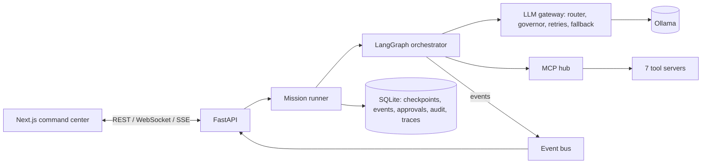
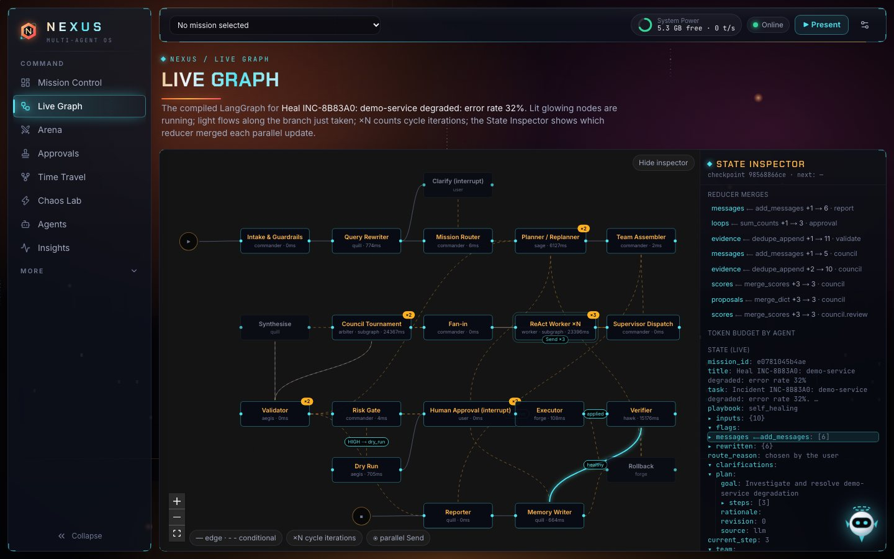

# NEXUS presentation guide

This guide explains what NEXUS is, what was built, and what works. It then walks through
every screen with a short demo you can follow: what to click, what will happen, and what
to say. A 7-minute demo order and answers to likely questions are at the end.

---

## 1. NEXUS in one minute

NEXUS is a **multi-agent operating system that runs entirely on a laptop**. You type a
task, and a team of 14 AI agents works on it together. The agents plan, research, write
code, test it in a sandbox and debate. They stop and **ask a human before anything
risky**. Every step is saved, so you can **rewind and replay** a mission.

What makes it different:

- **Everything is local.** The models are open models running through Ollama
  (`llama3.2:3b` by default). There are no cloud APIs and no API keys, and the cloud
  spend is $0.
- **You can watch it think.** Every robot animation in Live mode is triggered by a real
  backend event: an agent thinking, a tool call, a handoff, a test result. Nothing is
  faked.
- **Evidence beats opinion.** For code fixes, three solver agents compete. Each patch is
  proven by running real tests in a sandbox, and a judge weighs the test results before
  anything else.
- **A human stays in control.** Risky actions pause the workflow until you approve, either
  in the app or from a signed, single-use email link.
- **It can heal itself.** Inject a real bug into a live demo service. NEXUS notices,
  reproduces it, fixes it, asks you, applies the fix, checks it on live traffic, rolls back
  if needed and remembers the fix for next time.

**Stack (one line each)**

- **Backend:** Python 3.12, FastAPI, LangGraph (the workflow engine), Ollama, SQLite
  (persistence and checkpoints), ChromaDB (long-term memory), MCP (the tool protocol).
- **Frontend:** Next.js 15, TypeScript, Tailwind v4, motion (animation), React Flow (the
  live graph).

---

## 2. How to run it

```bash
make setup     # install backend + frontend dependencies, create .env
make models    # pull llama3.2:3b + nomic-embed-text (~2.3 GB)
make dev       # development: backend :8000, frontend :3000
make prod      # fastest: optimised frontend build, no reloaders (use this for a demo)
```

Open <http://localhost:3000>.

- **No Ollama?** Start with `NEXUS_LLM_PROVIDER=simulation`. A scripted model answers
  instead, and the UI shows a purple **SIMULATION** badge so nobody is misled.
- **Approval emails:** `make mail` starts Mailpit (inbox at <http://localhost:8025>).
  Without it, emails go to an outbox table, and the approval card tells you that.
- **Before a demo:** open the **Chaos Lab**, press **Restore baseline**, and keep
  **Auto-heal** switched on.

---

## 3. How it works (the architecture)



In plain words:

1. **A mission starts.** The **Commander** (the supervisor agent) reads the task and
   routes it to a **playbook**: a ready-made workflow such as "fix a bug" or "answer a
   question".
2. **The workflow is a LangGraph graph.** Each step is a node: intake, rewrite, route,
   plan, assemble team, dispatch, workers, council, validate, risk gate, approval,
   execute, verify, remember, report. Parallel work uses LangGraph's `Send` (fan-out) and
   reducers (fan-in).
3. **All model calls go through one gateway.** It picks the model, queues calls when RAM
   is low (the **Resource Governor**), retries with backoff, falls back to a smaller
   context, and opens a **circuit breaker** if a model keeps failing.
4. **Agents only touch the world through MCP tools.** Each agent has an allowlist. For
   example, only Swift can send email, and only after approval.
5. **Every step emits events.** They are saved to SQLite and streamed to the browser.
   The UI is driven only by those events.
6. **Every step is checkpointed in SQLite.** That makes crash recovery and time travel
   possible.

---

## 4. The squad (14 agents)

| Agent | Role | What it does | Tools it may use |
|---|---|---|---|
| **Commander** | Supervisor | Routes the mission, picks the team, delegates. Never does the work itself. | none |
| **Sage** | Planner | Breaks the task into small, verifiable steps. | knowledge search |
| **Echo** | Scout | Investigates: reads code, logs, tickets and docs, and cites sources. | knowledge, workspace (read), observability, tickets |
| **Quill** | Scribe | Rewrites the request clearly and writes the final report. | none |
| **Forge** | Engineer | Writes code changes and runs tests. | workspace (read/write), sandbox tests |
| **Aegis** | Guardian | Writes tests that prove the bug, and verifies fixes. | workspace, sandbox |
| **Blaze** | Solver | Tournament strategy: the minimal safe fix. | workspace (read), knowledge |
| **Volt** | Solver | Tournament strategy: the root-cause fix. | workspace (read), knowledge |
| **Frost** | Solver | Tournament strategy: the defensive fix. | workspace (read), knowledge |
| **Arbiter** | Judge | Picks the winner, weighing test evidence first. | none |
| **Vex** | Critic | Devil's advocate; looks for what could go wrong. | workspace (read) |
| **Swift** | Messenger | Sends emails and ticket comments, only when approved. | notify email, ticket comments |
| **Hawk** | Watcher | Polls the live service and opens incidents. | observability (health, logs, metrics) |
| **Nova** | Guide | The help bot in the corner; explains NEXUS. | none |

Every agent is a **YAML spec** (persona, prompt, model role, temperature, tool
allowlist). You can create or edit agents from the UI.

**The playbooks (workflows)**

| Playbook | What happens |
|---|---|
| **Self-Healing** (flagship) | Detect, reproduce, fix by tournament, approve, apply, verify on live traffic, roll back if needed, and learn. |
| **Ticket Solver** | Reads a ticket, writes a failing acceptance test, fixes it by tournament, and attaches the evidence to the ticket after approval. |
| **Project Builder** | Builds a small FastAPI CRUD API or CLI tool (≤ 8 files) from requirements, with tests, and packages it as a zip. |
| **Council Q&A** | Parallel answers, anonymous peer review, debate on disagreement, and a verdict with a confidence score. |
| **Dynamic** | For anything else. The Commander builds a team from the registry, and you approve the team before it starts. |

---

## 5. Screen-by-screen demo

The left sidebar has 8 main screens. Memory, Tools, How it Works and Settings sit under
**More**. The top bar is always visible:

- the **mission switcher**;
- **System Power**: free RAM and tokens per second;
- one **Online** status dot, covering the backend and the live event stream;
- **▶ Present**: a guided, auto-advancing tour;
- the **display settings** button: theme, sound and performance mode.

Global shortcuts: **⌘K / Ctrl+K** opens the command palette, and **Nova** (the robot,
bottom right) answers questions and can navigate for you.

---

### 5.1 Landing page (`/`)


**What it is:** the first impression. An animated sci-fi hero shows the title, a
holographic core, the robot squad and live statistics read from the backend: missions,
local LLM calls, tokens, and $0 cloud spend.

**Demo:**

1. Let the page load. The title letters rise in, the tagline types itself, and the
   Commander waves.
2. Point at the stats strip: "These numbers are real. They come from the backend, not
   from a mock."
3. Scroll down to show the **mission flow** (8 steps from intake to remember) and the six
   capability cards.
4. Click **Enter Command Center**, or **Watch the tour** to start the guided tour.

**Say:** "Everything here runs on this laptop: a local 3-billion-parameter model through
Ollama, no cloud, no API keys."

---

### 5.2 Mission Control (`/missions`): the main screen


**What it is:** where missions start and where you watch them.

- **Left:** the **New mission** form (pick a playbook or "Let the Commander decide") and
  the list of missions.
- **Centre:** the **Mission Floor**, an animated command deck where each robot stands at
  its post. Above it, a **stage strip** shows the workflow steps lighting up.
- **Right:** the **Thought Stream**, a live log of each agent's reasoning: Thought,
  Action, Observation, decisions and retries. You can filter it.
- **Bottom:** the **Report** (answer, code diff, highlights) and the **Checkpoints** bar.

**Demo:**

1. Leave "Let the Commander decide" selected. Type *"What is the difference between
   ReAct and Plan-and-Execute agents?"* and click **Begin mission**.
2. Watch the robots:
   - glowing **data orbs** fly from the Commander to the workers when it delegates;
   - robots show **expanding rings while thinking**, **sparks while using a tool**, an
     **RGB glitch while retrying**, a **hologram card while waiting for approval**, and
     a **spin and light burst on success**.
3. Point at the Thought Stream filling with real reasoning text.
4. Toggle **Floor ↔ Graph** to see the same mission as the LangGraph diagram.
5. When it finishes, open the **Report** and click a checkpoint, which opens Time Travel.
6. Click **Replay**. The finished mission is re-played from its recorded events at
   0.5×–8× speed, labelled "REPLAY — not live".

**Say:** "None of this motion is scripted. Each animation is triggered by a real event
from the backend. When the model calls a tool, the robot sparks; when a test passes,
a green light bar appears."

---

### 5.3 Live Graph (`/graph/<mission>`)



**What it is:** the actual compiled LangGraph, drawn live.

- The node that is running **glows**, and light particles flow along the edge just taken.
- **×N** badges count how many times a node ran (loops and retries).
- **Send ×3** shows a parallel fan-out.
- Dashed edges are conditional branches. Labels show the decision taken (for example
  `HIGH → dry_run`).
- The **State Inspector** (right) shows the graph state and **which reducer merged each
  parallel update** (for example `evidence — dedupe_append +2 → 10`).

**Demo:** open a finished self-healing mission and point at the ×2 badges on Plan and
Council (the second tournament round). Expand `plan` in the State Inspector.

**Say:** "This is the real graph, not a drawing of it. The reducer list shows how
parallel workers' results were merged safely."

---

### 5.4 Arena (`/arena/<mission>`)


**What it is:** the tournament and council, where agents compete and judge.

1. Three solvers (**Blaze**, **Volt**, **Frost**) propose fixes independently. They use
   the same model with different strategies and temperatures.
2. Each code patch is **run in its own sandbox**. Green or red light bars show tests
   passed or failed (for example 10✓ 0✗).
3. Proposals are **masked as A/B/C** for anonymous peer review, so reviewers can't
   favour a name.
4. If reviewers disagree, a **debate** round runs.
5. **Arbiter** gives the verdict (the balance tilts to the winner), with a confidence
   score and any dissent. Low confidence is **escalated to a human**.
6. The runner-up is remembered, so you can try it later in Time Travel.

**Say:** "Small models make mistakes, so we don't trust their opinions. We trust tests.
The winner is the patch that actually passes."

---

### 5.5 Approvals (`/approvals`)


**What it is:** the human-in-the-loop inbox. A mission pauses here with LangGraph
`interrupt()` and resumes with `Command(resume=…)`.

Kinds of approval:

- **Team approval** (dynamic missions): approve or edit the plan and the team.
- **Risky action** (applying a code fix): shows a **risk gauge**, the **diff**, the
  **dry-run result** and your options: Approve, Reject, or edit.
- **Question for you:** an agent needs clarification.

The **Audit Log** tab lists every decision and who made it (UI or email).

**Demo:** during a self-healing mission, open the approval card. Show the risk score
(HIGH), the diff and the dry run, then click **Approve**. An **APPROVED** stamp lands and
the mission continues.

**Say:** "Approval also works from email. The link is signed and single-use, and opening
it only shows a confirmation page, so a link-preview bot can't approve by accident."

---

### 5.6 Time Travel (`/timetravel/<mission>`)


**What it is:** every LangGraph super-step is a **SQLite checkpoint**, drawn as hexagons
on a holographic rail.

- **Cyan:** a normal checkpoint.
- **Gold:** has a verdict.
- **Coral:** an interrupt.
- **Violet:** a fork you created.

Click any checkpoint to see the **full state** at that moment. Then you can:

- **Re-run from this checkpoint**;
- **Choose the tournament runner-up instead**, which forks history so the second-best
  patch is used;
- **Fork with a state patch**: edit the state as JSON (for example raise the ReAct step
  limit) and run a new branch;
- **Compare branches** side by side.

**Demo:** click **Choose the tournament runner-up instead**. A new branch appears. Click
the compare button (main ⇄ runner-up) to see the branch comparison table.

**Say:** "Nothing is lost. We can rewind to any step, change one decision, and see how
the outcome changes."

---

### 5.7 Chaos Lab (`/chaos`)


**What it is:** a small real shop service (the **demo-service**, running on port 8100)
and **five chaos switches** that inject real bugs into its live source code:

| Switch | Symptom |
|---|---|
| Null-handling bug | Guest orders (no email) crash the pipeline |
| Off-by-one bug | Pagination silently drops the last order of each page |
| Bad config value | Tax rate entered as a percent: totals explode |
| Slow dependency | Inventory calls exceed their timeout |
| Schema mismatch | The producer renamed `price` to `unit_price` |

The ECG **heartbeat** shows the service's health live. **Hawk** watches from the catwalk.
Two unhealthy readings in a row open an **incident**, and with **Auto-heal** on, the
Self-Healing mission starts automatically.

**Demo (the flagship):**

1. Arm **Null-handling bug**. The switch turns red and the heartbeat spikes.
2. Hawk raises the alarm (red siren), and the app's background turns red (incident mode).
3. Go to Mission Control and open the new "Heal INC-…" mission.
4. Follow it to the Arena (the tournament), then Approvals (approve), then back to
   Mission Control.
5. Watch the fix get applied, then **verified on live traffic**. The sky turns to dawn
   colours and the victory burst plays.
6. **Restore baseline** when done.

**Say:** "That was a real bug in a running service. It reproduced it with a test, fixed
it, asked me, applied it on a git branch with hot reload, and checked 100+ live orders.
If errors had come back, it would have rolled back on its own."

---

### 5.8 Agents (`/agents`)


**What it is:** the agent registry, with a card for each robot.

- Hover a card and the robot **waves**. Click it to **flip** the card and see its spec:
  persona, model role, temperature, max steps, context size and tool allowlist.
- **+ New agent** or **Edit** opens a form that saves the YAML spec.
- The **Reputation leaderboard** ranks agents by tournament wins and mission results. The
  Commander uses reputation when it builds a team.
- **Playground:** pick an agent, type a task and click **Run one ReAct task** to run a
  single real ReAct loop with that agent's tools.

**Say:** "Agents are data, not code. Adding a new specialist is a YAML file, and its tool
access is limited by its allowlist."

---

### 5.9 Insights (`/insights`), with three tabs


**Observatory tab:** everything measured, nothing guessed.

- Totals: recent missions, LLM calls, local tokens, a labelled cloud-cost *comparison*
  (what it would cost on a paid API), and retries absorbed.
- **Trace waterfall:** OpenTelemetry spans per mission: node, LLM and tool timings.
- Tokens by purpose, routing decisions, retries, circuit-breaker states.
- **Resource Governor** charts: RAM used % and tokens/second over time.

**Benchmarks tab:** three live benchmark suites that run against your local model, one at
a time. Results are reported honestly, including failures:

| Suite | Result on llama3.2:3b |
|---|---|
| Raw SDK agent vs LangGraph agent | Both 2/3 correct, ~3.9 s and ~1,600 tokens per task |
| Council vs single model | Single 4/4 in ~3 s; council 3/4 in ~23 s (a council only helps when tests decide) |
| Sliding window vs summarisation pruning | Window kept 0/3 early facts, summary kept 1/3, so summarise is the default |

**Under the Hood tab:** the same task run two ways: an agent with **no framework**
(direct Ollama SDK and plain functions) next to the **LangGraph** worker. It shows what
the framework adds.

**Say:** "We report negative results too. For easy questions, a council just adds
latency. Its value is in code, where tests decide."

---

### 5.10 Memory (`/memory`)


**What it is:** both kinds of memory.

- **Short-term:** each agent's **context vessel** fills as its prompt grows toward the
  budget. When it gets close, older turns are **pruned** (sliding window) or **folded into
  a summary** (the default). The vessel visibly drops and shows a "pruned" marker.
- **Long-term:** stored in **ChromaDB**: the Fix Library, past missions, project docs and
  lessons.
- The **embedding map** is a 2-D PCA projection of every stored vector. Search to make
  matching memories glow.
- **Library:** browse the collections and open any stored item.
- **Semantic search** across all collections.

**Say:** "When the same bug happens again, the remembered fix is fed into the tournament
as a seed, so the second time is faster."

---

### 5.11 Tools (`/tools`)


**What it is:** NEXUS's **7 MCP servers**, each with live health, call counts and ping:

| Server | Tools |
|---|---|
| workspace | read_file, list_files, search, write_file (jailed to the mission folder) |
| sandbox | run_tests, run_command, status (no network, CPU/RAM limits) |
| knowledge | search, stats (RAG over ChromaDB) |
| tickets | list, get, comment, attach |
| notify | send_email (**system-only**, requires approval) |
| observability | health, read_logs, metrics |
| demo | calculator, count_letters, lookup_fact |

Click a server, then a tool chip, to see its **input schema** and **call it live** in a
playground workspace. **Recent calls** shows every call with arguments, result and
duration.

**Say:** "Agents can't touch files or send email directly. Everything goes through MCP,
filtered per agent. That's our security boundary."

---

### 5.12 How it Works (`/learn`), with two tabs

**Architecture tab:** an interactive diagram of the system. Click any component for a
plain-English explanation. While a mission runs, light packets travel the real request
path.

**Curriculum Map tab:** every Week-4 course topic (Days 16–20), where it is implemented in
the code, where to see it in the UI, and a **live "seen" counter** showing how many real
events of that kind have been recorded on this machine.

**Say:** "This maps every course concept to code and proves it ran here, with event
counts."

---

### 5.13 Settings (`/settings`)

- **Models:** profile (`lite` = 3B everywhere; `standard` = 7B coder), the main, fast and
  embedding models, the fallback chain, the context window, and the Ollama URL.
- **Live knobs** (applied immediately): LLM concurrency, pruning strategy, the verify
  window, auto-heal, and the per-mission token cap.
- **Appearance:** Sunset or Night theme, performance mode (pauses ambient animation),
  sound.
- **Safety policies:** for example email requires approval, patches require approval,
  the sandbox has no network, the workspace is jailed, and critical actions are blocked.

---

### 5.14 Always-available features

- **Nova, the guide** (robot, bottom right): ask "how does time travel work?" or "show me
  the tools". It answers from the project docs plus live mission state, and can
  **navigate**, **spotlight** an element, start the **tour**, or start a **demo mission**.
- **Command palette (⌘K):** jump to any screen, start missions, inject chaos, open
  checkpoints, or ask Nova.
- **▶ Present:** an auto-advancing guided tour with spotlights, useful when presenting.
- **System Power** (top bar): free RAM and tokens per second from the Resource Governor.
- **Sky moods:** the background reacts to system state. It is calm normally, red during
  an incident, and dawn after a successful heal.

---

## 6. Suggested 7-minute demo order

| Time | Screen | Action |
|---|---|---|
| 0:00 | Landing | Let the Commander wave, then click **Enter Command Center** |
| 0:20 | Top bar | Hover System Power: "a 16 GB Mac stays responsive" |
| 0:40 | How it Works → Curriculum | Show the course topics with live event counts |
| 1:10 | Chaos Lab | Arm **Null-handling bug** and watch the heartbeat and red sky |
| 1:40 | Mission Control | Open the Heal mission: fan-out orbs, Thought Stream |
| 2:30 | Graph toggle | The real LangGraph, with glowing nodes and ×N loops |
| 3:00 | Arena | Three solvers, sandbox test bars, anonymous review, verdict |
| 3:50 | Approvals | Risk gauge, diff, dry run, then **Approve** |
| 4:30 | Mission Control | Execute, verify on live traffic, dawn sky and victory burst |
| 5:10 | Time Travel | Choose the runner-up, then compare branches |
| 6:00 | Memory | The fix is now in the Fix Library |
| 6:30 | Nova | "Explain how reducers merged the parallel findings" |

**If the model struggles live:** the tournament often needs a second round, because the
validator feeds failing tests back. That is the system working as designed: show the red
bars, then the green ones. Without Ollama, run Simulation mode and say so (the badge
shows it).

---

## 7. What is working and verified

**Verified on this laptop with llama3.2:3b:**

- **Self-heal, end to end:**
  - the null-handling bug opened an incident;
  - in the first council round the patches failed 2/10 tests, and the failing tests were
    fed into round 2;
  - the winning patch passed 10/10 in the sandbox;
  - it was scored HIGH risk, went through a dry run, and was approved by a human;
  - it was applied, and **103 live orders produced 0 new errors**;
  - it was promoted to `main` and stored in the Fix Library.
- **Crash recovery:** a backend restart mid-mission resumed from the SQLite checkpoint.
- **Token cap policy:** a mission was stopped at 124,576 tokens against the 120,000 cap,
  safely, with a dead-letter record.

**Automated tests (all passing):**

| Area | Tests |
|---|---|
| Backend (pytest) | 71 tests: reducers, pruning, guardrails, risk, tournament scoring, LLM gateway, governor, all MCP servers, graph routing, fan-out/fan-in, interrupts, crash resume, email tokens, time travel, every playbook end to end, API compression |
| Frontend unit (vitest) | 11 tests: the event reducer, robot state machine, legacy-id mapping, scenery |
| End-to-end (Playwright) | 10 tests: every screen with zero console errors, landing, sidebar, tabs, settings, command palette, agent roster, Nova navigation, a full mission with approval, a time-travel fork |
| Quality gates | ruff + mypy --strict (backend), eslint + prettier + tsc strict (frontend) |

**Performance:**

- Pages load in about 0.55–0.85 s in production mode.
- API responses are 2–25 ms, and large responses are gzip-compressed.
- Heavy tabs load only when opened.

---

## 8. Honest limitations (say these before you're asked)

- **Small-model quality.** A 3B model often needs a second tournament round, and free-form
  planning and Project Builder output can be hit-and-miss. The safeguards (validation,
  fallbacks, tests) keep missions **safe**, not always successful.
- **Sandbox isolation needs Docker.** Without it, tests run in a local subprocess, which
  the UI clearly labels as "not isolated".
- **Email needs Mailpit** (or any SMTP server). Otherwise messages go to an outbox table.
- **Subgraphs are not checkpointed internally,** so a crash mid-tournament re-runs that
  tournament step.
- **Single user, no login.** It is meant to run on localhost.

---

## 9. Likely questions and answers

**Why LangGraph and not plain code?**
It gives us checkpoints (crash recovery and time travel), interrupts (human approval),
parallel `Send` with reducers, and retry policies for free. The Under the Hood tab shows
the same agent without a framework, for comparison.

**How do you stop agents doing something dangerous?**
Four layers:
1. Agents act only through MCP tools, filtered by a per-agent allowlist.
2. Risky actions are scored and need human approval.
3. File access is jailed to the mission workspace, and the sandbox has no network.
4. Untrusted text (logs, tickets, tool output) is fenced, so the model is told never to
   obey it.

**Why three solvers instead of one?**
Small models are unreliable, so we generate diverse options and let **tests** choose. The
benchmark shows a council doesn't help on easy questions, which is why we only use it
where evidence decides.

**What happens if the laptop runs low on memory?**
The Resource Governor watches RAM and queues LLM calls instead of crashing. System Power
in the top bar shows it.

**Is the animation fake?**
No. In Live mode, every animation comes from a real backend event. Replay mode re-plays
recorded events and is labelled. Simulation mode uses a scripted model and shows a badge.

**What if the fix breaks something?**
After applying it, NEXUS watches live traffic for a verify window. If errors return, it
rolls back automatically.

**Where is each course topic implemented?**
In the app: How it Works → Curriculum Map. In the repo: `docs/TOPIC_COVERAGE.md`.

---

## 10. Where to look in the repo

| What | Where |
|---|---|
| Workflow graph | `backend/nexus/graph/` |
| Playbooks | `backend/nexus/playbooks/` |
| Agent specs (YAML) | `backend/nexus/agents/specs/` |
| MCP tool servers | `backend/nexus/mcp_servers/` |
| LLM gateway, governor, retries | `backend/nexus/llm/`, `backend/nexus/reliability/`, `backend/nexus/core/governor.py` |
| Human approval and email | `backend/nexus/hitl/` |
| UI screens | `frontend/src/app/(app)/` |
| Robots and animation | `frontend/src/components/robots/`, `frontend/src/lib/robotMachine.ts` |
| Architecture and decisions | `docs/ARCHITECTURE.md`, `docs/adr/` |
| Course topic map | `docs/TOPIC_COVERAGE.md` |
