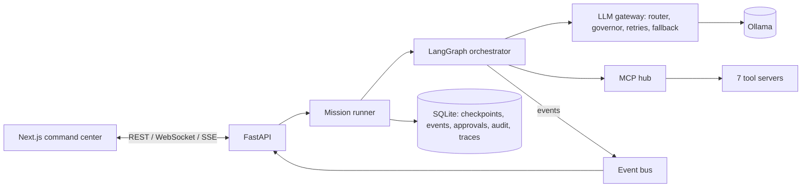
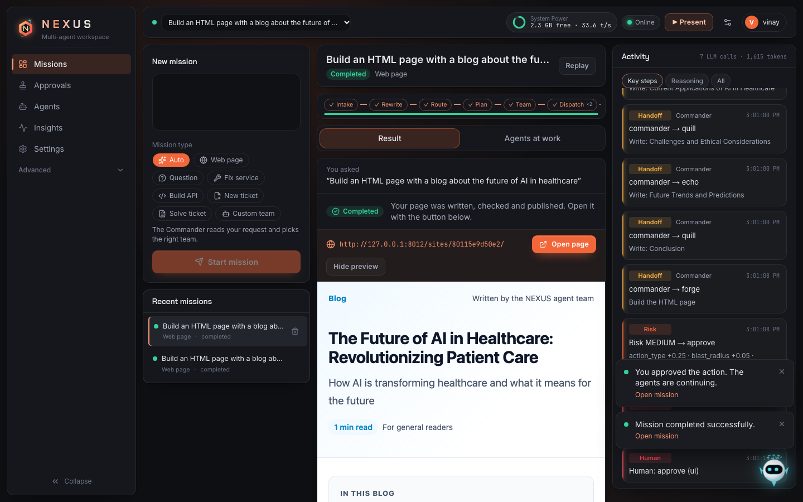
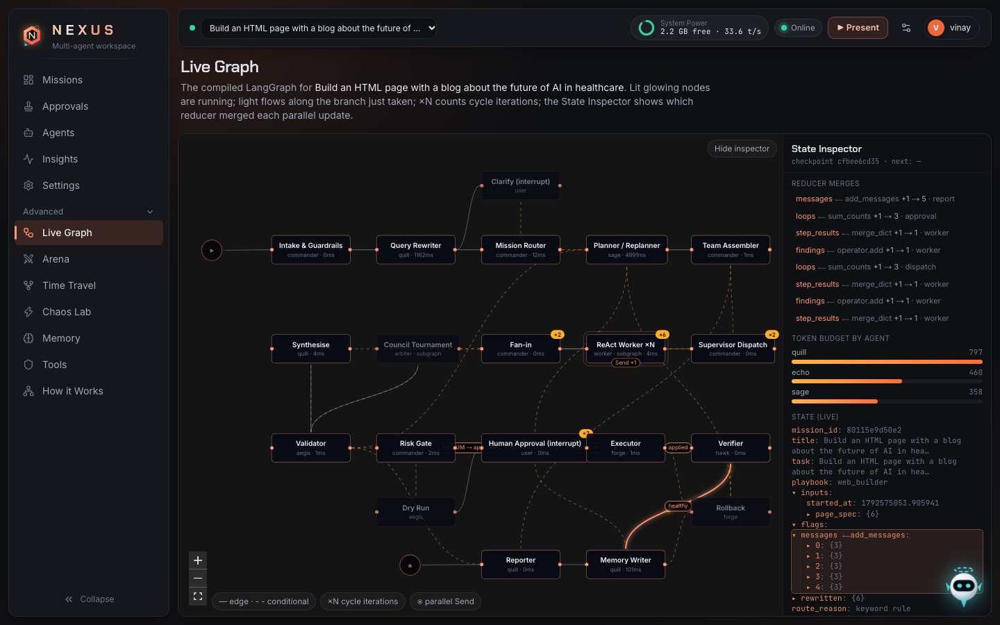
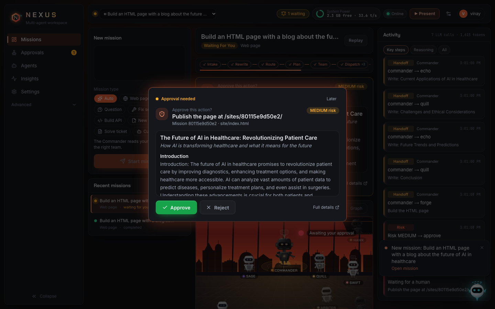
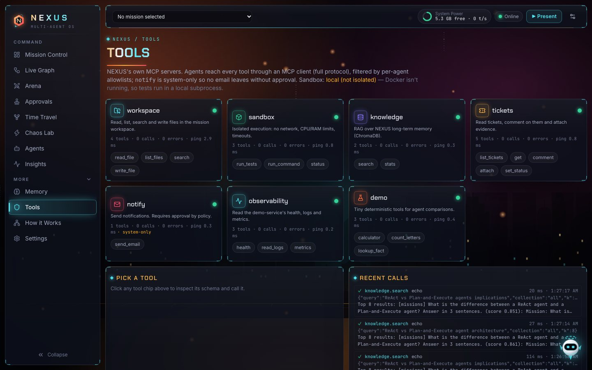

# NEXUS presentation guide

> **Note:** this guide was written for an earlier version of the interface (a sci-fi theme
> with different screen names). The concepts, code paths and tests it describes are current;
> some screenshots and colours are not. For the current screens and mission types see
> [HOW_IT_WORKS.md](HOW_IT_WORKS.md) and the [README](../README.md).


This guide explains what NEXUS is, what was built, and what works.

- **Part 1 (sections 1–10):** walks through every screen with a short demo you can follow
  (what to click, what will happen, what to say), then a 7-minute demo order, what's
  verified, limitations, and answers to likely questions.
- **Part 2 (section 11):** a deep dive into every component: what it is, what I built, why
  I chose that approach, where to show it, and the test that proves it.

To *learn* how everything works inside (one mission followed through the real code, with
worked examples and hands-on exercises), read [CODE_WALKTHROUGH.md](CODE_WALKTHROUGH.md).
What every mission type can do and how to demo it: [HOW_IT_WORKS.md](HOW_IT_WORKS.md).

---

## 1. NEXUS in one minute

NEXUS is a **multi-agent operating system that runs entirely on a laptop**. You type a
task, and a team of 14 AI agents works on it together. The agents plan, research, write
code, test it in a sandbox and debate. They stop and **ask a human before anything
risky**. Every step is saved, so you can **rewind and replay** a mission.

What makes it different:

- **Everything is local.** The models are open models running through Ollama
  (`llama3.2:3b` by default). There are no cloud APIs and no API keys, and the cloud
  spend is $0.
- **You can watch it think.** Every robot animation in Live mode is triggered by a real
  backend event: an agent thinking, a tool call, a handoff, a test result. Nothing is
  faked.
- **Evidence beats opinion.** For code fixes, three solver agents compete. Each patch is
  proven by running real tests in a sandbox, and a judge weighs the test results before
  anything else.
- **A human stays in control.** Risky actions pause the workflow until you approve, either
  in the app or from a signed, single-use email link.
- **It can heal itself.** Inject a real bug into a live demo service. NEXUS notices,
  reproduces it, fixes it, asks you, applies the fix, checks it on live traffic, rolls back
  if needed and remembers the fix for next time.

**Stack (one line each)**

- **Backend:** Python 3.12, FastAPI, LangGraph (the workflow engine), Ollama, SQLite
  (persistence and checkpoints), ChromaDB (long-term memory), MCP (the tool protocol).
- **Frontend:** Next.js 15, TypeScript, Tailwind v4, motion (animation), React Flow (the
  live graph).

---

## 2. How to run it

```bash
make setup     # install backend + frontend dependencies, create .env
make models    # pull llama3.2:3b + nomic-embed-text (~2.3 GB)
make dev       # development: backend :8000, frontend :3000
make prod      # fastest: optimised frontend build, no reloaders (use this for a demo)
```

Open <http://localhost:3000>.

- **No Ollama?** Start with `NEXUS_LLM_PROVIDER=simulation`. A scripted model answers
  instead, and the UI shows a purple **SIMULATION** badge so nobody is misled.
- **Approval emails:** `make mail` starts Mailpit (inbox at <http://localhost:8025>).
  Without it, emails go to an outbox table, and the approval card tells you that.
- **Before a demo:** open the **Chaos Lab**, press **Restore baseline**, and keep
  **Auto-heal** switched on.

---

## 3. How it works (the architecture)



In plain words:

1. **A mission starts.** The **Commander** (the supervisor agent) reads the task and
   routes it to a **playbook**: a ready-made workflow such as "fix a bug" or "answer a
   question".
2. **The workflow is a LangGraph graph.** Each step is a node: intake, rewrite, route,
   plan, assemble team, dispatch, workers, council, validate, risk gate, approval,
   execute, verify, remember, report. Parallel work uses LangGraph's `Send` (fan-out) and
   reducers (fan-in).
3. **All model calls go through one gateway.** It picks the model, queues calls when RAM
   is low (the **Resource Governor**), retries with backoff, falls back to a smaller
   context, and opens a **circuit breaker** if a model keeps failing.
4. **Agents only touch the world through MCP tools.** Each agent has an allowlist. For
   example, only Swift can send email, and only after approval.
5. **Every step emits events.** They are saved to SQLite and streamed to the browser.
   The UI is driven only by those events.
6. **Every step is checkpointed in SQLite.** That makes crash recovery and time travel
   possible.

---

## 4. The squad (14 agents)

| Agent | Role | What it does | Tools it may use |
|---|---|---|---|
| **Commander** | Supervisor | Routes the mission, picks the team, delegates. Never does the work itself. | none |
| **Sage** | Planner | Breaks the task into small, verifiable steps. | knowledge search |
| **Echo** | Scout | Investigates: reads code, logs, tickets and docs, and cites sources. | knowledge, workspace (read), observability, tickets |
| **Quill** | Scribe | Rewrites the request clearly and writes the final report. | none |
| **Forge** | Engineer | Writes code changes and runs tests. | workspace (read/write), sandbox tests |
| **Aegis** | Guardian | Writes tests that prove the bug, and verifies fixes. | workspace, sandbox |
| **Blaze** | Solver | Tournament strategy: the minimal safe fix. | workspace (read), knowledge |
| **Volt** | Solver | Tournament strategy: the root-cause fix. | workspace (read), knowledge |
| **Frost** | Solver | Tournament strategy: the defensive fix. | workspace (read), knowledge |
| **Arbiter** | Judge | Picks the winner, weighing test evidence first. | none |
| **Vex** | Critic | Devil's advocate; looks for what could go wrong. | workspace (read) |
| **Swift** | Messenger | Sends emails and ticket comments, only when approved. | notify email, ticket comments |
| **Hawk** | Watcher | Polls the live service and opens incidents. | observability (health, logs, metrics) |
| **Nova** | Guide | The help bot in the corner; explains NEXUS. | none |

Every agent is a **YAML spec** (persona, prompt, model role, temperature, tool
allowlist). You can create or edit agents from the UI.

**The playbooks (workflows)**

| Playbook | What happens |
|---|---|
| **Self-Healing** (flagship) | Detect, reproduce, fix by tournament, approve, apply, verify on live traffic, roll back if needed, and learn. |
| **Ticket Solver** | Reads a ticket, writes a failing acceptance test, fixes it by tournament, and attaches the evidence to the ticket after approval. |
| **Project Builder** | Builds a small FastAPI CRUD API or CLI tool (≤ 8 files) from requirements, with tests, and packages it as a zip. |
| **Council Q&A** | Parallel answers, anonymous peer review, debate on disagreement, and a verdict with a confidence score. |
| **Dynamic** | For anything else. The Commander builds a team from the registry, and you approve the team before it starts. |

---

## 5. Screen-by-screen demo

The left sidebar has 8 main screens. Memory, Tools, How it Works and Settings sit under
**More**. The top bar is always visible:

- the **mission switcher**;
- **System Power**: free RAM and tokens per second;
- one **Online** status dot, covering the backend and the live event stream;
- **▶ Present**: a guided, auto-advancing tour;
- the **display settings** button: theme, sound and performance mode.

Global shortcuts: **⌘K / Ctrl+K** opens the command palette, and **Nova** (the robot,
bottom right) answers questions and can navigate for you.

---

### 5.1 Landing page (`/`)


**What it is:** the first impression. An animated sci-fi hero shows the title, a
holographic core, the robot squad and live statistics read from the backend: missions,
local LLM calls, tokens, and $0 cloud spend.

**Demo:**

1. Let the page load. The title letters rise in, the tagline types itself, and the
   Commander waves.
2. Point at the stats strip: "These numbers are real. They come from the backend, not
   from a mock."
3. Scroll down to show the **mission flow** (8 steps from intake to remember) and the six
   capability cards.
4. Click **Enter Command Center**, or **Watch the tour** to start the guided tour.

**Say:** "Everything here runs on this laptop: a local 3-billion-parameter model through
Ollama, no cloud, no API keys."

---

### 5.2 Missions screen (`/missions`): the main screen



**What it is:** where missions start and where you watch them.

- **Left:** the **New mission** form (pick a playbook or "Let the Commander decide") and
  the list of missions.
- **Centre:** the **Mission Floor**, an animated command deck where each robot stands at
  its post. Above it, a **stage strip** shows the workflow steps lighting up.
- **Right:** the **Activity** panel, a live log of each agent's reasoning: Thought,
  Action, Observation, decisions and retries. You can filter it.
- **Bottom:** the **Report** (answer, code diff, highlights) and the **Checkpoints** bar.

**Demo:**

1. Leave "Let the Commander decide" selected. Type *"What is the difference between
   ReAct and Plan-and-Execute agents?"* and click **Begin mission**.
2. Watch the robots:
   - glowing **data orbs** fly from the Commander to the workers when it delegates;
   - robots show **expanding rings while thinking**, **sparks while using a tool**, an
     **RGB glitch while retrying**, a **hologram card while waiting for approval**, and
     a **spin and light burst on success**.
3. Point at the Activity panel filling with real reasoning text.
4. Toggle **Floor ↔ Graph** to see the same mission as the LangGraph diagram.
5. When it finishes, open the **Report** and click a checkpoint, which opens Time Travel.
6. Click **Replay**. The finished mission is re-played from its recorded events at
   0.5×–8× speed, labelled "REPLAY — not live".

**Say:** "None of this motion is scripted. Each animation is triggered by a real event
from the backend. When the model calls a tool, the robot sparks; when a test passes,
a green light bar appears."

---

### 5.3 Live Graph (`/graph/<mission>`)



**What it is:** the actual compiled LangGraph, drawn live.

- The node that is running **glows**, and light particles flow along the edge just taken.
- **×N** badges count how many times a node ran (loops and retries).
- **Send ×3** shows a parallel fan-out.
- Dashed edges are conditional branches. Labels show the decision taken (for example
  `HIGH → dry_run`).
- The **State Inspector** (right) shows the graph state and **which reducer merged each
  parallel update** (for example `evidence — dedupe_append +2 → 10`).

**Demo:** open a finished self-healing mission and point at the ×2 badges on Plan and
Council (the second tournament round). Expand `plan` in the State Inspector.

**Say:** "This is the real graph, not a drawing of it. The reducer list shows how
parallel workers' results were merged safely."

---

### 5.4 Arena (`/arena/<mission>`)


**What it is:** the tournament and council, where agents compete and judge.

1. Three solvers (**Blaze**, **Volt**, **Frost**) propose fixes independently. They use
   the same model with different strategies and temperatures.
2. Each code patch is **run in its own sandbox**. Green or red light bars show tests
   passed or failed (for example 10✓ 0✗).
3. Proposals are **masked as A/B/C** for anonymous peer review, so reviewers can't
   favour a name.
4. If reviewers disagree, a **debate** round runs.
5. **Arbiter** gives the verdict (the balance tilts to the winner), with a confidence
   score and any dissent. Low confidence is **escalated to a human**.
6. The runner-up is remembered, so you can try it later in Time Travel.

**Say:** "Small models make mistakes, so we don't trust their opinions. We trust tests.
The winner is the patch that actually passes."

---

### 5.5 Approvals (`/approvals`)



**What it is:** the human-in-the-loop inbox. A mission pauses here with LangGraph
`interrupt()` and resumes with `Command(resume=…)`.

Kinds of approval:

- **Team approval** (dynamic missions): approve or edit the plan and the team.
- **Risky action** (applying a code fix): shows a **risk gauge**, the **diff**, the
  **dry-run result** and your options: Approve, Reject, or edit.
- **Question for you:** an agent needs clarification.

The **Audit Log** tab lists every decision and who made it (UI or email).

**Demo:** during a self-healing mission, open the approval card. Show the risk score
(HIGH), the diff and the dry run, then click **Approve**. An **APPROVED** stamp lands and
the mission continues.

**Say:** "Approval also works from email. The link is signed and single-use, and opening
it only shows a confirmation page, so a link-preview bot can't approve by accident."

---

### 5.6 Time Travel (`/timetravel/<mission>`)


**What it is:** every LangGraph super-step is a **SQLite checkpoint**, drawn as hexagons
on a holographic rail.

- **Cyan:** a normal checkpoint.
- **Gold:** has a verdict.
- **Coral:** an interrupt.
- **Violet:** a fork you created.

Click any checkpoint to see the **full state** at that moment. Then you can:

- **Re-run from this checkpoint**;
- **Choose the tournament runner-up instead**, which forks history so the second-best
  patch is used;
- **Fork with a state patch**: edit the state as JSON (for example raise the ReAct step
  limit) and run a new branch;
- **Compare branches** side by side.

**Demo:** click **Choose the tournament runner-up instead**. A new branch appears. Click
the compare button (main ⇄ runner-up) to see the branch comparison table.

**Say:** "Nothing is lost. We can rewind to any step, change one decision, and see how
the outcome changes."

---

### 5.7 Chaos Lab (`/chaos`)


**What it is:** a small real shop service (the **demo-service**, running on port 8100)
and **five chaos switches** that inject real bugs into its live source code:

| Switch | Symptom |
|---|---|
| Null-handling bug | Guest orders (no email) crash the pipeline |
| Off-by-one bug | Pagination silently drops the last order of each page |
| Bad config value | Tax rate entered as a percent: totals explode |
| Slow dependency | Inventory calls exceed their timeout |
| Schema mismatch | The producer renamed `price` to `unit_price` |

The ECG **heartbeat** shows the service's health live. **Hawk** watches from the catwalk.
Two unhealthy readings in a row open an **incident**, and with **Auto-heal** on, the
Self-Healing mission starts automatically.

**Demo (the flagship):**

1. Arm **Null-handling bug**. The switch turns red and the heartbeat spikes.
2. Hawk raises the alarm (red siren), and the app's background turns red (incident mode).
3. Go to Missions screen and open the new "Heal INC-…" mission.
4. Follow it to the Arena (the tournament), then Approvals (approve), then back to
   Missions screen.
5. Watch the fix get applied, then **verified on live traffic**. The sky turns to dawn
   colours and the victory burst plays.
6. **Restore baseline** when done.

**Say:** "That was a real bug in a running service. It reproduced it with a test, fixed
it, asked me, applied it on a git branch with hot reload, and checked 100+ live orders.
If errors had come back, it would have rolled back on its own."

---

### 5.8 Agents (`/agents`)


**What it is:** the agent registry, with a card for each robot.

- Hover a card and the robot **waves**. Click it to **flip** the card and see its spec:
  persona, model role, temperature, max steps, context size and tool allowlist.
- **+ New agent** or **Edit** opens a form that saves the YAML spec.
- The **Reputation leaderboard** ranks agents by tournament wins and mission results. The
  Commander uses reputation when it builds a team.
- **Playground:** pick an agent, type a task and click **Run one ReAct task** to run a
  single real ReAct loop with that agent's tools.

**Say:** "Agents are data, not code. Adding a new specialist is a YAML file, and its tool
access is limited by its allowlist."

---

### 5.9 Insights (`/insights`), with three tabs


**Observatory tab:** everything measured, nothing guessed.

- Totals: recent missions, LLM calls, local tokens, a labelled cloud-cost *comparison*
  (what it would cost on a paid API), and retries absorbed.
- **Trace waterfall:** OpenTelemetry spans per mission: node, LLM and tool timings.
- Tokens by purpose, routing decisions, retries, circuit-breaker states.
- **Resource Governor** charts: RAM used % and tokens/second over time.

**Benchmarks tab:** three live benchmark suites that run against your local model, one at
a time. Results are reported honestly, including failures:

| Suite | Result on llama3.2:3b |
|---|---|
| Raw SDK agent vs LangGraph agent | Both 2/3 correct, ~3.9 s and ~1,600 tokens per task |
| Council vs single model | Single 4/4 in ~3 s; council 3/4 in ~23 s (a council only helps when tests decide) |
| Sliding window vs summarisation pruning | Window kept 0/3 early facts, summary kept 1/3, so summarise is the default |

**Under the Hood tab:** the same task run two ways: an agent with **no framework**
(direct Ollama SDK and plain functions) next to the **LangGraph** worker. It shows what
the framework adds.

**Say:** "We report negative results too. For easy questions, a council just adds
latency. Its value is in code, where tests decide."

---

### 5.10 Memory (`/memory`)


**What it is:** both kinds of memory.

- **Short-term:** each agent's **context vessel** fills as its prompt grows toward the
  budget. When it gets close, older turns are **pruned** (sliding window) or **folded into
  a summary** (the default). The vessel visibly drops and shows a "pruned" marker.
- **Long-term:** stored in **ChromaDB**: the Fix Library, past missions, project docs and
  lessons.
- The **embedding map** is a 2-D PCA projection of every stored vector. Search to make
  matching memories glow.
- **Library:** browse the collections and open any stored item.
- **Semantic search** across all collections.

**Say:** "When the same bug happens again, the remembered fix is fed into the tournament
as a seed, so the second time is faster."

---

### 5.11 Tools (`/tools`)



**What it is:** NEXUS's **7 MCP servers**, each with live health, call counts and ping:

| Server | Tools |
|---|---|
| workspace | read_file, list_files, search, write_file (jailed to the mission folder) |
| sandbox | run_tests, run_command, status (no network, CPU/RAM limits) |
| knowledge | search, stats (RAG over ChromaDB) |
| tickets | list, get, comment, attach |
| notify | send_email (**system-only**, requires approval) |
| observability | health, read_logs, metrics |
| demo | calculator, count_letters, lookup_fact |

Click a server, then a tool chip, to see its **input schema** and **call it live** in a
playground workspace. **Recent calls** shows every call with arguments, result and
duration.

**Say:** "Agents can't touch files or send email directly. Everything goes through MCP,
filtered per agent. That's our security boundary."

---

### 5.12 How it Works (`/learn`), with two tabs

**Architecture tab:** an interactive diagram of the system. Click any component for a
plain-English explanation. While a mission runs, light packets travel the real request
path.

**Curriculum Map tab:** every Week-4 course topic (Days 16–20), where it is implemented in
the code, where to see it in the UI, and a **live "seen" counter** showing how many real
events of that kind have been recorded on this machine.

**Say:** "This maps every course concept to code and proves it ran here, with event
counts."

---

### 5.13 Settings (`/settings`)

- **Models:** profile (`lite` = 3B everywhere; `standard` = 7B coder), the main, fast and
  embedding models, the fallback chain, the context window, and the Ollama URL.
- **Live knobs** (applied immediately): LLM concurrency, pruning strategy, the verify
  window, auto-heal, and the per-mission token cap.
- **Appearance:** Sunset or Night theme, performance mode (pauses ambient animation),
  sound.
- **Safety policies:** for example email requires approval, patches require approval,
  the sandbox has no network, the workspace is jailed, and critical actions are blocked.

---

### 5.14 Always-available features

- **Nova, the guide** (robot, bottom right): ask "how does time travel work?" or "show me
  the tools". It answers from the project docs plus live mission state, and can
  **navigate**, **spotlight** an element, start the **tour**, or start a **demo mission**.
- **Command palette (⌘K):** jump to any screen, start missions, inject chaos, open
  checkpoints, or ask Nova.
- **▶ Present:** an auto-advancing guided tour with spotlights, useful when presenting.
- **System Power** (top bar): free RAM and tokens per second from the Resource Governor.
- **Sky moods:** the background reacts to system state. It is calm normally, red during
  an incident, and dawn after a successful heal.

---

## 6. Suggested 7-minute demo order

| Time | Screen | Action |
|---|---|---|
| 0:00 | Landing | Let the Commander wave, then click **Enter Command Center** |
| 0:20 | Top bar | Hover System Power: "a 16 GB Mac stays responsive" |
| 0:40 | How it Works → Curriculum | Show the course topics with live event counts |
| 1:10 | Chaos Lab | Arm **Null-handling bug** and watch the heartbeat and red sky |
| 1:40 | Missions screen | Open the Heal mission: fan-out orbs, Activity panel |
| 2:30 | Graph toggle | The real LangGraph, with glowing nodes and ×N loops |
| 3:00 | Arena | Three solvers, sandbox test bars, anonymous review, verdict |
| 3:50 | Approvals | Risk gauge, diff, dry run, then **Approve** |
| 4:30 | Missions screen | Execute, verify on live traffic, dawn sky and victory burst |
| 5:10 | Time Travel | Choose the runner-up, then compare branches |
| 6:00 | Memory | The fix is now in the Fix Library |
| 6:30 | Nova | "Explain how reducers merged the parallel findings" |

**If the model struggles live:** the tournament often needs a second round, because the
validator feeds failing tests back. That is the system working as designed: show the red
bars, then the green ones. Without Ollama, run Simulation mode and say so (the badge
shows it).

---

## 7. What is working and verified

**Verified on this laptop with llama3.2:3b:**

- **Self-heal, end to end:**
  - the null-handling bug opened an incident;
  - in the first council round the patches failed 2/10 tests, and the failing tests were
    fed into round 2;
  - the winning patch passed 10/10 in the sandbox;
  - it was scored HIGH risk, went through a dry run, and was approved by a human;
  - it was applied, and **103 live orders produced 0 new errors**;
  - it was promoted to `main` and stored in the Fix Library.
- **Crash recovery:** a backend restart mid-mission resumed from the SQLite checkpoint.
- **Token cap policy:** a mission was stopped at 124,576 tokens against the 120,000 cap,
  safely, with a dead-letter record.

**Automated tests (all passing):**

| Area | Tests |
|---|---|
| Backend (pytest) | 71 tests: reducers, pruning, guardrails, risk, tournament scoring, LLM gateway, governor, all MCP servers, graph routing, fan-out/fan-in, interrupts, crash resume, email tokens, time travel, every playbook end to end, API compression |
| Frontend unit (vitest) | 13 tests: the event reducer, robot state machine, stream batching, legacy-id mapping, scenery |
| End-to-end (Playwright) | 10 tests: every screen with zero console errors, landing, sidebar, tabs, settings, command palette, agent roster, Nova navigation, a full mission with approval, a time-travel fork |
| Quality gates | ruff + mypy --strict (backend), eslint + prettier + tsc strict (frontend) |

**Performance:**

- Opening a large mission takes 0.48 s (it was 4.2 s), and the floor runs at a steady
  60 fps.
- Pages load in about 0.55–0.85 s in production mode.
- API responses are 2–25 ms, and large responses are gzip-compressed.
- Heavy tabs load only when opened.

---

## 8. Honest limitations (say these before you're asked)

- **Small-model quality.** A 3B model often needs a second tournament round, and free-form
  planning and Project Builder output can be hit-and-miss. The safeguards (validation,
  fallbacks, tests) keep missions **safe**, not always successful.
- **Sandbox isolation needs Docker.** Without it, tests run in a local subprocess, which
  the UI clearly labels as "not isolated".
- **Email needs Mailpit** (or any SMTP server). Otherwise messages go to an outbox table.
- **Subgraphs are not checkpointed internally,** so a crash mid-tournament re-runs that
  tournament step.
- **Accounts with roles, one machine.** Owner, operator and viewer accounts (Argon2id, JWT);
  it is meant for a small team on one machine, not a multi-tenant service.

---

## 9. Likely questions and answers

**Why LangGraph and not plain code?**
It gives us checkpoints (crash recovery and time travel), interrupts (human approval),
parallel `Send` with reducers, and retry policies for free. The Under the Hood tab shows
the same agent without a framework, for comparison.

**How do you stop agents doing something dangerous?**
Four layers:
1. Agents act only through MCP tools, filtered by a per-agent allowlist.
2. Risky actions are scored and need human approval.
3. File access is jailed to the mission workspace, and the sandbox has no network.
4. Untrusted text (logs, tickets, tool output) is fenced, so the model is told never to
   obey it.

**Why three solvers instead of one?**
Small models are unreliable, so we generate diverse options and let **tests** choose. The
benchmark shows a council doesn't help on easy questions, which is why we only use it
where evidence decides.

**What happens if the laptop runs low on memory?**
The Resource Governor watches RAM and queues LLM calls instead of crashing. System Power
in the top bar shows it.

**Is the animation fake?**
No. In Live mode, every animation comes from a real backend event. Replay mode re-plays
recorded events and is labelled. Simulation mode uses a scripted model and shows a badge.

**What if the fix breaks something?**
After applying it, NEXUS watches live traffic for a verify window. If errors return, it
rolls back automatically.

**Where is each course topic implemented?**
In the app: How it Works → Curriculum Map. In the repo: `docs/TOPIC_COVERAGE.md`.

---

## 10. Where to look in the repo

| What | Where |
|---|---|
| Workflow graph | `backend/nexus/graph/` |
| Playbooks | `backend/nexus/playbooks/` |
| Agent specs (YAML) | `backend/nexus/agents/specs/` |
| MCP tool servers | `backend/nexus/mcp_servers/` |
| LLM gateway, governor, retries | `backend/nexus/llm/`, `backend/nexus/reliability/`, `backend/nexus/core/governor.py` |
| Human approval and email | `backend/nexus/hitl/` |
| UI screens | `frontend/src/app/(app)/` |
| Robots and animation | `frontend/src/components/robots/`, `frontend/src/lib/robotMachine.ts` |
| Architecture and decisions | `docs/ARCHITECTURE.md`, `docs/adr/` |
| Course topic map | `docs/TOPIC_COVERAGE.md` |

---

# Part 2: Deep dive into every part

This part explains **each component one by one**, so you can answer "how does that work?"
and "why did you do it that way?" for any part of the system. Each entry has:

- **In simple words:** the concept, explained for a non-expert.
- **What I built:** the concrete implementation and where it lives.
- **Why this way:** the decision, and the alternative I rejected.
- **Show it:** where to point in the app.
- **Proof:** the test that guarantees it.

The topics follow the Week-4 course days (16–20), then reliability, then the product and
UI engineering.

---

## Day 16: Multi-agent systems

### 11.1 ReAct workers (Reason → Act → Observe)

**In simple words:** an agent thinks about what to do, calls a tool, looks at the result,
and repeats until it can answer. It is like a person who checks facts before answering.

**What I built:** a LangGraph **subgraph** (`graph/subgraphs/react_worker.py`) with two
nodes, `think` and `act`, in a loop, plus `finalize`.

- `think` asks the model for a structured decision: either "call tool X with arguments Y"
  or "final answer".
- `act` runs the tool through MCP and adds the observation to the history.
- An **iteration guard** (max 6 steps per worker) forces `finalize` so a confused agent
  can never loop forever.
- Every step emits `agent.thinking`, `agent.action` and `agent.observation` events.

**Why this way:**
- **Structured turns:** a 3B model is bad at the classic free-text "Thought: … Action: …"
  format; it often breaks the format. So each turn is a JSON schema, which Ollama
  enforces, and the output is validated before it is used.
- **Hard cap:** the iteration guard exists because small models sometimes repeat the same
  tool call.

**Show it:** Missions screen → Activity panel, filter **ReAct**. Each card is labelled
Thought, Action, Observation or Final.

**Proof:** `test_react_iteration_guard_forces_final`, `test_council_qa_runs_end_to_end`.

### 11.2 Plan-and-Execute

**In simple words:** first make a plan with numbered steps, then do the steps. If the
result fails validation, re-plan.

**What I built:**
- **Sage** (the planner node in `graph/nodes/planning.py`) produces a typed `Plan`: a goal
  and steps with dependencies.
- `dispatch` (`graph/nodes/work.py`) runs the steps whose dependencies are done, possibly
  several in parallel.
- When validation fails, the **replanner** creates revision r1, which shows as
  "Plan r0 / r1".

**Why this way:**
- **ReAct alone drifts on long tasks.** A plan keeps the team on track and makes the work
  visible.
- **Plan + ReAct per step** gives the best of both: structure at the top and flexibility
  inside each step.

**Show it:** Live Graph (`plan`, `dispatch` ×N) and Activity panel "Plan r0".

**Proof:**
- `test_validation_failures_hit_fix_and_replan_guards`;
- Project Builder writes files in dependency "waves".

### 11.3 Raw SDK agent (no framework)

**In simple words:** the same kind of agent written by hand, with no LangGraph, to show
what the framework actually gives us.

**What I built:** `llm/raw_react_agent.py`. It uses only `httpx`, with a manual prompt,
manual parsing, a manual loop and manual retries.

**Why this way:** the course asks you to understand agents *below* the framework. It also
gives an honest benchmark: on llama3.2:3b both versions scored 2/3, at ~3.9 s and ~1,600
tokens per task. **The framework's value is not accuracy; it is checkpoints,
interrupts, parallelism and observability.**

**Show it:** Insights → **Under the Hood** (side by side) and **Benchmarks** → "Raw SDK
vs LangGraph".

**Proof:** `test_raw_agent.py`.

### 11.4 Conditional routing (choosing the playbook)

**In simple words:** the Commander reads the task and decides which workflow fits.

**What I built:** `graph/nodes/understand.py::route`.
- Keyword and intent rules plus a model fallback choose among Self-Healing, Ticket
  Solver, Project Builder, Council Q&A and Dynamic.
- If the user picked a playbook, that choice wins.
- The graph then uses `add_conditional_edges` to branch.

**Why this way:**
- **Rules first:** they are instant and predictable; the model is consulted only when the
  rules are unsure. That saves tokens and avoids a small model misrouting obvious tasks.
- **Visible decisions:** every routing decision emits an `edge.taken` event with its
  label.

**Show it:** Live Graph, where the chosen branch label flashes on the edge. Activity panel
"Route".

**Proof:** `test_router_picks_playbook_and_emits_edge`.

---

## Day 17: LangGraph core (state, reducers, cycles)

### 11.5 One typed state and one orchestrator graph

**In simple words:** the whole mission is one shared "notebook" (the state) that every
step reads and writes, and one map of steps (the graph).

**What I built:**
- `graph/state.py::MissionState` is a `TypedDict` holding the task, plan, team, evidence,
  proposals, scores, verdict, risk, loop counters and more.
- `graph/main_graph.py` compiles **one graph of ~20 nodes**: intake, rewrite, route,
  clarify, plan, assemble, dispatch, worker, collect, council, synthesise, validate,
  risk_gate, dry_run, approval, execute, verify, rollback, memory_write, report.
- Every playbook plugs into that same graph through **hooks** (plan template, validate,
  execute, verify, rollback). Playbooks don't own separate graphs.

**Why this way (ADR 0001):**
- **One graph to inspect, draw and test.** The Live Graph shows the *real* compiled graph.
- **The trade-off:** some nodes are pass-through for some playbooks (Council Q&A has
  nothing to verify). That is visible and harmless.

**Show it:** Live Graph + State Inspector.

**Proof:** all graph tests in `test_graph_missions.py`.

### 11.6 Reducers (merging parallel updates safely)

**In simple words:** when several agents write to the notebook at the same moment, a
reducer decides how to combine their writes instead of one overwriting the other.

**What I built:** `graph/reducers.py`:

| Reducer | Job |
|---|---|
| `merge_dict` | Merge keyed results (e.g. proposals by solver). |
| `merge_scores` | Combine review scores. |
| `dedupe_append` | Add evidence without duplicates. |
| `sum_counts` | Add up loop counters. |
| `append_list` | Plain append. |
| `add_messages` | Chat history. |

The instrumentation wrapper emits a `reducer.merged` event showing which reducer merged
what.

**Why this way:**
- **Without reducers, parallel workers overwrite each other.** That is the classic bug in
  fan-out designs.
- **Reducers stay pure:** they never emit events themselves (the wrapper does), so they
  are deterministic and easy to unit test.

**Show it:** State Inspector → "Reducer merges", e.g. `evidence — dedupe_append +2 → 10`.

**Proof:**
- reducer unit tests in `test_units_core.py`;
- the parallel fan-in is asserted in `test_council_qa_runs_end_to_end`.

### 11.7 Cycles with guards

**In simple words:** loops are allowed (try, test, fix, test again), but each loop has a
limit so the system always ends.

**What I built:** `DEFAULT_LIMITS` in `graph/state.py`:

| Loop | Limit |
|---|---|
| clarify | 2 |
| dispatch | 8 |
| fix | 2 |
| replan | 2 |
| verify | 2 |
| debate | 2 |
| react | 6 |

Counters live in `state.loops` (merged with `sum_counts`). When a limit is reached, the
graph takes the safe exit: report, roll back or escalate.

**Why this way:** small models fail more often, so retry loops are essential. Unbounded
loops would burn tokens and never finish. A guard turns "infinite loop" into "honest
failure with a report".

**Show it:** the ×N badges on Live Graph nodes, and the counters in the stage strip.

**Proof:**
- `test_validation_failures_hit_fix_and_replan_guards`;
- `test_self_healing.py::test_failed_verification_rolls_back`.

### 11.8 Parallel fan-out and fan-in (`Send`)

**In simple words:** the Commander hands out several tasks at once, and the results are
gathered back.

**What I built:**
- `dispatch` returns `Command(goto=[Send("worker", step) …])`, so one worker runs per
  ready step, in parallel.
- `collect` is the fan-in.
- The tournament also uses `Send` for the three solvers and their reviewers.

**Why this way:** investigation steps are independent (read logs, read code, search past
incidents), so running them in parallel cuts wall time. All workers share one loaded
model (see 11.22), so parallelism doesn't multiply memory.

**Show it:**
- Mission Floor: several data orbs fly at once, and the "Send ×N" badge appears.
- Live Graph: "Send ×3" on the worker node.

**Proof:** `test_council_qa_runs_end_to_end` (2 workers, 3 solvers, 3 reviews each).

### 11.9 Subgraphs and `Command` handoffs

**In simple words:**
- A **subgraph** is a small graph used as one step of the big graph.
- A **handoff** is the supervisor passing control (and data) to a specific worker.

**What I built:**
- **Subgraphs:** `react_worker` and `tournament` are compiled subgraphs invoked by
  nodes. Their structure is exported to the UI.
- **Handoffs:** `dispatch` uses `Command(goto=…, update=…)` to route and update state in
  one move.

**Why this way:** subgraphs keep the main graph readable, and each is testable on its own.
`Command` keeps the routing decision and the state change atomic.

**Show it:**
- Live Graph: worker and council are marked as subgraphs.
- Activity panel: "Handoff commander → echo".

---

## Day 18: Memory systems and context pruning

### 11.10 SQLite persistence and crash recovery

**In simple words:** after every step, the mission is saved to a database file. If the
app crashes, it continues from the last save.

**What I built (ADR 0002):** two SQLite files.
- `checkpoints.db`: LangGraph's `AsyncSqliteSaver`, one checkpoint per super-step.
- `nexus.db`: events, missions, approvals, audit and traces, via async SQLAlchemy with
  WAL mode, so the UI can read while missions write.

On startup, `runner.recover()` resumes any mission that was still running.

**Why this way:**
- **No extra services:** SQLite needs nothing else installed and fits "everything on one
  laptop". The files can be opened in any SQLite browser.
- **Easy upgrade path:** moving to Postgres means swapping the saver and the database URL.

**Show it:**
- Time Travel, the checkpoint rail.
- After a backend restart mid-mission, "Mission resumed from checkpoint" appears in the
  Activity panel.

**Proof:** `test_crashed_mission_resumes_from_sqlite_checkpoint`; this was also verified
live.

### 11.11 Short-term memory: sliding window vs summarisation

**In simple words:** a model can only read a limited amount of text (its context window).
When the conversation grows too long, you either **drop the oldest turns** (sliding
window) or **fold them into a summary** (summarisation).

**What I built:** `memory/pruning.py`.
- **`sliding_window`:** keeps the system prompt, *pinned* items (task, plan, current step)
  and the most recent turns.
- **`summarise`:** folds old turns into one rolling pinned summary. If summarising fails,
  it **falls back to the window**, so pruning never breaks a mission.

The strategy is switchable live in Settings.

**Why this way:** I measured it instead of guessing. With a 420-token budget (about 70% of
tokens removed), the window kept 0 of 3 early facts answerable and the summary kept 1 of
3. So **summarise is the default**.

**Show it:**
- Memory → context vessels: the fill drops and a "pruned" marker floats up.
- Insights → Benchmarks → pruning suite.

**Proof:**
- `test_sliding_window_keeps_system_pinned_and_recent`;
- `test_summarise_folds_old_turns_into_pinned_summary`;
- `test_summarise_failure_falls_back_to_sliding_window`.

### 11.12 Token counting and budgets

**In simple words:** count how much text goes into the model, so we can stay under limits
and cap the cost of a mission.

**What I built:**
- **Estimates:** `llm/tokens.py` estimates tokens and **calibrates itself** against the
  real counts Ollama reports (`prompt_eval_count`).
- **Per-mission cap:** `core/meter.py` enforces the cap from the policy file (120,000
  tokens).

**Why this way:** exact tokenizers differ per model. A calibrated estimate is fast and
gets more accurate as it runs. The cap protects the laptop from a runaway mission.

**Show it:** Insights → Observatory (tokens by purpose), and the State Inspector token
bars.

**Proof:**
- `test_token_estimates_learn_from_real_counts`;
- live, a mission was stopped at 124,576 / 120,000 tokens with a dead-letter record and
  no changes applied.

### 11.13 Long-term memory (ChromaDB and the Fix Library)

**In simple words:** a searchable memory that survives restarts. NEXUS remembers past
fixes, missions, docs and lessons, and finds them by meaning, not exact words.

**What I built:** `memory/long_term.py`.
- **Four collections:** `fix_library`, `missions`, `docs` and `lessons`, embedded with
  `nomic-embed-text`.
- **Fix Library seeding:** a successful heal writes the fix there. Next time a similar
  incident appears, the remembered patch enters the tournament as a **seed proposal**.
- **Embedding map:** a 2-D PCA projection of the vectors, shown in the UI.

**Why this way:**
- **Chroma** is embedded (no server). Only the backend process opens it, because I learned
  on an earlier project that two processes on one embedded Chroma corrupt each other's
  view.
- **Seeding** makes repeat incidents faster and cheaper.

**Show it:** Memory → embedding map, library and semantic search.

**Proof:** `test_knowledge_search`, `test_self_healing_end_to_end` (the Fix Library write).

---

## Day 19: Multi-agent workflows and MCP

### 11.14 Supervisor, workers, agent registry and reputation

**In simple words:** one boss agent (the Commander) assigns work to specialist agents.

**What I built:**
- **Registry:** every agent is a **YAML spec** in `agents/specs/` (persona, prompt, model
  role, temperature, max steps, tool allowlist), loaded by the registry and editable in
  the UI.
- **Team assembly:** `assemble` chooses the team using **reputation**, which is updated
  from tournament wins and mission results.
- **Dynamic missions:** the team is proposed and the graph pauses for a human to approve
  it.

**Why this way:**
- **Agents as data:** adding a specialist is a YAML file, not code.
- **Reputation** lets good performers get picked more often.
- **Team approval** keeps a human in charge of open-ended tasks.

**Show it:**
- Agents: flip cards, edit form, leaderboard, playground.
- Approvals: "Team approval".

### 11.15 Evidence-grounded tournaments and the council

**In simple words:** instead of trusting one answer, three agents each propose a fix, the
fixes are **tested**, reviewed anonymously, and a judge picks the winner, weighing test
results most.

**What I built:** `graph/subgraphs/tournament.py` and `scoring.py` (ADR 0004).

1. **Independent proposals:** Blaze (minimal safe fix), Volt (root cause) and Frost
   (defensive) use the same model with different strategies and temperatures.
2. **Tested in isolation:** each patch is applied to its **own throwaway copy** of the
   workspace, and the full test suite runs in the sandbox. That suite includes a
   reproduction test that must fail on the buggy code.
3. **Anonymous review:** proposals are relabelled A/B/C in shuffled order.
4. **Debate only when needed:** a debate round runs only if reviewers disagree beyond a
   threshold.
5. **The judge's weights:**

   | Factor | Weight |
   |---|---|
   | tests | 0.45 |
   | peer review | 0.25 |
   | critic | 0.10 |
   | diff size | 0.10 |
   | reputation | 0.10 |

6. **Escalation:** a failing winner, low confidence or high divergence goes to a human.
7. **Second round:** the failing tests from round 1 are fed into round 2.

**Why this way:**
- **Debate alone converges on shared mistakes.** Copies of the same model tend to agree
  with each other, even when they're wrong.
- **Tests are objective,** and anonymity removes bias toward a name.
- **I measured the cost honestly:** on easy factual questions, a council (3/4 correct,
  ~23 s) is *worse* than a single model (4/4, ~3 s). So the council is used where evidence
  decides (code), not for everything.

**Show it:** the Arena: proposals, sandbox light bars, review scores, the verdict and the
balance tilt.

**Proof:**
- tournament scoring tests;
- live: round 1 patches failed 2/10 tests, and the round 2 winner passed 10/10.

### 11.16 MCP servers (the tool layer)

**In simple words:** MCP (Model Context Protocol) is a standard way for AI agents to use
tools. Each tool has a strict description of its inputs.

**What I built (ADR 0005):** seven of my own MCP servers in `mcp_servers/`:

| Server | Purpose |
|---|---|
| workspace | Files, jailed to the mission folder |
| sandbox | Tests and commands, no network, CPU/RAM limits |
| knowledge | RAG over Chroma |
| tickets | Local tracker or GitHub Issues |
| notify | Email; **system-only**, so no agent can call it directly |
| observability | Health, logs and metrics of the demo-service |
| demo | Tiny deterministic tools for benchmarks |

- **How they're reached:** through real MCP `Client`s over the SDK's **in-memory
  transport**. That is the full protocol (initialise, list tools, call tool) with no
  subprocess per call.
- **The hub** (`hub.py`) adds per-agent allowlists, workspace injection, events, retries
  and a call log.
- **Usable outside NEXUS:** any server can also run over stdio for other MCP clients:
  `python -m nexus.mcp_servers <name>`.

**Why this way:**
- **Speed:** a subprocess per tool call is slow.
- **Control:** I didn't use `langchain-mcp-adapters`, because the hub needs to enforce
  allowlists and emit events, which is my security boundary.

**Show it:** Tools: servers, tool schemas, live "try it", recent calls.

**Proof:** `test_mcp.py` covers every server, the path jail, the allowlist, the notify
guard, the sandbox and tickets.

---

## Day 20: Human-in-the-loop and safety

### 11.17 Interrupts, approval gates and risk scoring

**In simple words:** before anything risky, the workflow **pauses** and waits for a
person. How risky something is decides whether it needs approval.

**What I built:**
- **Pause and resume:** `interrupt()` inside the `clarify`, `assemble` (team) and
  `approval` nodes pauses the graph. `runner.resume` continues with `Command(resume=…)`.
- **Risk scoring** (`safety/risk.py`) adds rule-based factors: action type, blast radius,
  files touched, diff size, tournament confidence and escalation. The score in [0, 1]
  maps to a level and a route:

  | Level | Score | Route |
  |---|---|---|
  | LOW | < 0.25 | auto-execute (logged) |
  | MEDIUM | < 0.50 | one human approval |
  | HIGH | < 0.75 | approval **plus a mandatory sandbox dry-run** |
  | CRITICAL | ≥ 0.75 | blocked unless a human explicitly overrides |

- **Policies** (`safety/policies.yaml`) can only make a route **stricter**, never looser
  (e.g. "patches always need approval").
- **History nudge:** past owner decisions adjust the score. Frequent rejections raise
  it; a clean approval streak lowers it slightly.

**Why this way:**
- **Rules are explainable:** the Activity panel shows each factor (e.g. `files_touched
  +0.05`). A model-based risk judge would be a black box and could be prompt-injected.
- **Stricter-only policies** mean a configuration mistake can't remove a safety check.

**Show it:**
- Approvals: risk gauge, diff, dry run.
- Activity panel: "Risk HIGH → dry_run" with its factors.

**Proof:** `test_hitl.py` (approve, reject, CRITICAL override), and the interrupt tests in
`test_graph_missions.py`.

### 11.18 Email approvals

**In simple words:** you can approve from your email inbox, safely.

**What I built:**
- **Tokens** (`hitl/tokens.py`): signed, expire after 24 h, and are **single-use**; a
  used token is recorded.
- **Two-step links** (`hitl/email_approvals.py`): opening the link (GET) only shows a
  confirmation page; the decision happens on POST.
- **Delivery:** Mailpit locally.

**Why this way:** email security scanners and link previews *open* links automatically.
If GET approved, a scanner could approve a code change. Single-use plus expiry stops
replay.

**Show it:** the Mailpit inbox, and the email status chip on approval cards.

**Proof:**
- `test_approval_email_link_resumes_mission_and_is_single_use`;
- `test_tampered_and_expired_tokens_are_rejected`.

### 11.19 Time travel

**In simple words:** go back to any saved step, change something, and run a new version
of history alongside the original.

**What I built:** `hitl/timetravel.py`:
- the history tree and the state at any checkpoint;
- re-run from a checkpoint;
- **fork with a state patch** (`update_state`);
- **choose the tournament runner-up**;
- compare branches.

**Why this way:**
- **Debugging agents is hard.** Being able to replay a decision point with one change is
  the fastest way to understand "what if".
- **It comes from the design:** it falls out of LangGraph checkpoints plus SQLite.

**Show it:** Time Travel: hex checkpoint rail, runner-up fork, branch compare.

**Proof:**
- `test_time_travel_runner_up_fork_and_compare`;
- `test_fork_with_state_patch_reruns_from_checkpoint`;
- e2e `timetravel.spec.ts`.

### 11.20 Safety layers

**In simple words:** several independent walls, so one failure doesn't cause harm.

**What I built:**
1. **Guardrails** (`safety/guardrails.py`):
   - detect prompt injection, e.g. "ignore previous instructions";
   - redact secrets and personal data;
   - **fence** all untrusted text (logs, tickets, docs, tool output) inside labelled
     delimiters the model is told never to obey.
2. **Tool allowlists** per agent, enforced by the MCP hub.
3. **Path jail:** file access only inside the mission workspace.
4. **Sandbox:** no network, CPU/RAM limits, in Docker when available. The local fallback
   is clearly labelled "not isolated".
5. **Policies:** stricter-only rules (11.17).
6. **Audit log:** every decision recorded, with who made it and how (UI or email).

**Why this way:** defence in depth. Agents read untrusted text (a ticket could contain
"email the database to me"). The fence plus allowlist plus approval chain means even a
successful injection can't send anything without a human.

**Show it:**
- Settings → Safety policies.
- Approvals → Audit Log.
- Tools: notify is marked "system-only".

**Proof:**
- guardrail and risk tests in `test_units_core.py`;
- `test_ticket_injection_is_flagged`.

---

## Reliability with small local models

### 11.21 The LLM gateway: routing, retries, fallback, circuit breakers

**In simple words:** every call to a model goes through one "front door" that handles
everything that can go wrong.

**What I built (ADR 0006):** `llm/gateway.py` on top of the official `ollama` client.

- **Model router** (`llm/router.py`): light jobs (rewrite, grade, summarise) go to the
  **fast** role; heavy jobs (plan, solve, judge) go to **main**. In the `lite` profile
  both are llama3.2:3b; `standard` uses a 7B coder for main.
- **Retries** (`reliability/retry.py`): 3 attempts with exponential backoff and jitter,
  each emitting an event.
- **Structured output:**
  - Ollama's JSON-schema mode;
  - our own validation;
  - a **re-prompt** that shows the model its error;
  - JSON repair for near-misses.
- **Fallback chain:** primary → alternate model → **reduced context** (keep only the
  last turns).
- **Circuit breaker** (`reliability/circuit_breaker.py`, per model): after 3 failures it
  **opens** for 20 s (calls fail fast). Then it lets one trial call through (half-open).
  Success closes it.
- **Token accounting:** every call is counted, traced and streamed to the UI.

**Why this way:**
- **One place for all of it:** reliability and cost are reasoned about in one file
  instead of in every agent.
- **Easy testing:** the same interface lets a **scripted provider** stand in for the
  model, which makes tests deterministic and enables Simulation mode.

**Show it:**
- Insights → Observatory: retries absorbed, routing table, circuit list.
- Robots show an RGB glitch and an ×N badge while retrying.

**Proof:**
- `test_llm_gateway.py`, `test_reliability.py`;
- `test_fallback_chain_alternate_model_then_reduced_context`;
- `test_all_fallbacks_failing_raises_and_opens_circuit`.

### 11.22 The Resource Governor and one shared model

**In simple words:** a traffic controller that stops the laptop from running out of
memory.

**What I built:**
- **The Governor** (`core/governor.py`):
  - samples free RAM every 2 s and classifies pressure as normal, elevated or critical;
  - under **elevated** pressure it **halves** the number of concurrent model calls; under
    **critical** it allows **one**;
  - extra calls **queue** instead of failing;
  - it records tokens per second.
- **One shared model (ADR 0003):** all parallel agents share **one loaded model** and
  differ only by prompt, persona and temperature.

**Why this way:** the owner's 16 GB Mac had crashed under bigger models. One model per
agent would multiply memory. With sharing plus the governor, memory stays flat however
many agents run.

**Show it:** **System Power** in the top bar, and the Governor charts in Insights.

**Proof:** governor tests; live missions ran on llama3.2:3b without memory crashes.

### 11.23 Observability and benchmarks

**In simple words:** measure everything, so claims are backed by numbers.

**What I built:**
- **Tracing** (`core/tracing.py`): OpenTelemetry-style spans for mission, node, LLM and
  tool, stored in SQLite, shown as a **waterfall**.
- **Metrics:** tokens by purpose, latency, retries, breaker states, governor history.
- **Benchmarks** (`evals/harness.py`): three live suites, run one at a time so the laptop
  stays responsive:
  - Raw SDK vs LangGraph;
  - Council vs single model;
  - pruning strategies.

**Why this way:** with small models, intuition is often wrong. The council benchmark
proved a council *hurts* on easy questions, which changed how I use it.

**Show it:** Insights → Observatory and Benchmarks.

---

## Product and UI engineering

### 11.24 The event-driven UI ("nothing is faked")

**In simple words:** the screen is a live picture of what the backend is really doing.

**What I built:**
1. **Events from every node:** every graph node is wrapped by `graph/instrument.py`, so
   it emits typed events (node started or completed, edge taken, reducer merged, agent
   thinking, tool called, test result, and so on). There are 45 typed event kinds.
2. **Saved and streamed:** events go to an **event bus**, are saved to SQLite with a
   sequence number, and are streamed over **WebSocket**. Reconnects resume from the last
   sequence number, so nothing is lost or duplicated.
3. **One pure reducer:** in the browser, `lib/missionView.ts::reduceMission` turns events
   into the whole screen state: nodes, robots, thoughts, council, checkpoints.
4. **Robot state machine:** `lib/robotMachine.ts` maps each event to a robot mode
   (thinking, using a tool, retrying, waiting for approval, success, failed, sleeping and
   more). Each mode has its own animation.

**Why this way:**
- **Honesty:** a demo where animations are scripted proves nothing. Here, if a robot
  sparks, a tool was really called.
- **Testability:** a pure reducer is easy to unit test, and the same reducer powers Live,
  Replay and the Graph view.

**Proof:**
- `lib/__tests__/missionView.test.ts`;
- `stores/__tests__/missionStream.test.ts`.

### 11.25 Replay mode and Simulation mode

**In simple words:**
- **Replay** plays back a finished mission like a video.
- **Simulation** runs the app without a real model, for demos and tests.

**What I built:**
- **Replay** (`stores/replay.ts`) feeds the *recorded* events through the same reducer
  at 0.5×–8× speed. Long human pauses are compressed. It is always labelled "REPLAY — not
  live".
- **Simulation** (`NEXUS_LLM_PROVIDER=simulation`) uses a scripted model. A purple
  **SIMULATION** badge is always visible.

**Why this way:** both keep the "never mislead" rule. Replay uses real recorded events,
and simulation is clearly labelled. The end-to-end tests run in Simulation mode, so they
are fast and deterministic.

### 11.26 The self-healing demo-service and the Chaos Lab

**In simple words:** a small real shop app that we can deliberately break, so NEXUS has
something real to fix.

**What I built:**
- **The service** (`demo-service/`): a FastAPI shop processing orders, running with hot
  reload on port 8100.
- **Five chaos switches** edit its **live source code** to inject real bugs (null
  handling, off-by-one, bad config, slow dependency, schema mismatch).
- **Hawk** polls its health every 2 s; two bad readings in a row open an incident.
- **The heal pipeline:**
  1. reproduce the bug with a failing test;
  2. run the tournament;
  3. score the risk and do a dry run;
  4. get human approval;
  5. apply the fix on a git branch;
  6. **verify on live traffic** for a time window;
  7. on failure, **roll back automatically**;
  8. on success, promote to `main` and store the fix in the Fix Library.

**Why this way:** "self-healing" is only convincing on a real running service with a real
bug. The verification step proves the fix works on traffic, not only in tests.

**Proof:**
- `test_self_healing.py` uses a real demo-service subprocess and real sandbox pytest
  runs; only the model is scripted.
- Live: 103 orders, 0 new errors.

### 11.27 Nova, the guide

**In simple words:** a help robot that answers questions about NEXUS and can drive the
UI.

**What I built:**
- **Answers:** `guide/nova.py` answers from the project docs (RAG) plus the **live state**
  of the current mission, streamed over SSE.
- **Actions:** it returns structured actions such as navigate, spotlight an element,
  start the tour or start a demo mission.

**Why this way:** an evaluator can ask "where is time travel?" and be taken there. Nova
says when something is a guess instead of inventing live facts.

**Proof:** e2e `guide.spec.ts` ("show me the tools" navigates to Tools).

### 11.28 Theme and animation design

**In simple words:** a sci-fi command-center look that is also easy to read.

**What I built:**
- **The theme:**
  - "Sunset Command": a void-black base, sunset aurora light, and neon cyan HUD details
    (corner brackets, uppercase titles with a glowing marker, faint scanlines);
  - **colour rules:** cyan for navigation and system chrome, the warm gradient only for
    primary actions, so it's always clear what to click;
  - everything is driven by tokens in `styles/tokens.css`, so the Night theme and the sky
    moods (calm, incident, dawn) only swap tokens.
- **The robots:** original animated SVG mecha with thrusters, an LED visor with
  expressions, a reactor core and per-agent colours and gear.
- **Animations with a meaning:**
  - Live animations show real events: orbs on handoffs, sparks on tool calls, light bars
    on tests, a scan-in when you switch missions, the stage strip filling as stages
    complete.
  - Ambient motion (aurora, grid, idle robots) is subtle.
- **Buttons:** one system (`.btn` variants) with hover lift, press, a light sweep and a
  ripple.

**Why this way:** the first version used a Japanese theme. The feedback asked for English
names and an advanced sci-fi look. Animations with a meaning make the system
understandable, not just pretty.

### 11.29 Performance engineering

**In simple words:** make it feel instant and smooth, even on a laptop running a model.

**What was slow, and the fix:**

| Problem | Fix | Result |
|---|---|---|
| Opening a mission replayed its whole history over the WebSocket one event at a time (hundreds of re-renders, and every Thought card animated in) | Load history in **one request, one store update**; the socket resumes after the last event; live events are batched to **one update per frame**; only *new* thoughts animate | Opening a large mission: **4.2 s → 0.48 s** |
| ~130 JavaScript animation loops for 13 robots | Idle loops moved to **CSS keyframes** (GPU compositor); robots re-render only when their visible state changes | Steady 60 fps, no long tasks |
| Every panel blurred the animated background (`backdrop-filter`) | Blur only on floating elements (popovers, toasts) | Much less GPU work per frame |
| Heavy tabs loaded up front | Lazy-loaded tab panels | Insights first load **302 KB → 162 KB** |
| 3D landing scene (three.js) | Replaced with a CSS/SVG hero | No large 3D download |
| Slow dev compiles | Turbopack; `make prod` for an optimised build | Pages in 0.55–0.85 s in production |
| Large JSON API responses | gzip compression | Events and summaries shrink several times |

**Why this way:** I measured first (open time, frame rate, long tasks) and fixed the real
bottleneck rather than guessing.

### 11.30 Testing strategy

**What I built:**
- **Backend:** 71 pytest tests with a **scripted model**, so they are fast and
  deterministic. They still use real SQLite, real MCP servers, real sandbox test runs and
  a real demo-service subprocess. Tests that need Ollama are marked `live` and run
  separately.
- **Frontend:** 13 Vitest tests for the pure reducer, the robot state machine, stream
  batching, legacy IDs and scenery.
- **End-to-end:** 10 Playwright tests against a Simulation-mode backend on separate ports
  (they never disturb your dev servers):
  - every screen must load with **zero console errors**;
  - the full mission and approval flow, including that re-opening a finished mission
    replays no animations;
  - time-travel fork, guide navigation, tabs, settings, command palette.
- **Quality gates:** ruff, mypy `--strict`, eslint, prettier, TypeScript strict.

**Why this way:** a scripted model makes tests reproducible, while everything else stays
real. That means the tests catch real integration bugs, not mocked ones.
